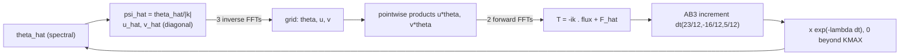

# The math of the SQG solver, why it lives in Fourier space, how we changed its step, and the MD-style energy-budget test

Written 2026-11-11 for the user's requests: "start the analysis with the math of the SQG, show all algebra and go
step by step and explain the need for the fourier space and why it is used", "compare the changes we just made that
borrow ideas from MD", and "include the discussion of how we modified the original SQG ... show every step and use
drawings".

Code referenced throughout: the hash-pinned production solver `SQG/fixed_ring/A-SQG_data.py` (pinned by
`SQG/fixed_ring/SHA256SUMS`, imported unmodified by every job through `SQG/analysis/profile_solver.py:import_asqg`;
`SQG/A-SQG_data.py` is the earlier 500-TU variant of the same physics — parameters, `decay`, `inner()` and
`diagnostics()` are line-for-line identical in both), its vendored helper `SQG/fixed_ring/sqg.py`, the installed
`pyqg_jax` (model `sqg_model.py`, stepper `steppers.py`, kernel `_kernel.py`), and the new energy harness in
`SQG/analysis/opt/energy/` (`energy_budget.py`, `analyze_energy.py`, `PREDICTIONS_energy.md`,
`run_energy_polaris.pbs`). Job 7836358 was still queued while Parts 1–7 were written, so they quote none of its
results. It has since run (PASS_E); §8.1 summarises the results, and notes Part XIV has the full write-up.
Statements that are explanations rather than measurements or derivations are marked *(inference)*; estimates are
marked *(estimate)*, as in `SQG/analysis/opt/delta/MATH_delta.md`.

## Contents

- **Part 1. The SQG equations from the start** — interior problem, the |k| inversion, velocities, dissipation and
  forcing, the flux-form Fourier equation, the two conservation laws, the discrete conventions, the invariants
  SPE and VIE, their budgets, the two cascades.
- **Part 2. Why the solver works in Fourier space** — diagonal inversion, exact derivatives, exact damping (and a
  stiffness check), exact invariants, the aliasing algebra of the 2/3 rule, exact Galerkin conservation, cost.
- **Part 3. Time stepping and its own energy error** — the AB3 coefficients derived, the integrating-factor error
  derived, and its budget signature r_IF.
- **Part 4. Floating point** — float32 spacing, mechanism A (quantized damping, with a computed table), mechanism B
  (state rounding), and the lean32ek fix (exact-rate table + compensated hi + lo state).
- **Part 5. How we modified the original SQG step** — the original step operation by operation, what the
  profiling found, seed 1 (bitwise `lean_u1`), seed 2 (C2C packing + precision variants), the precision
  repairs (`lean32e`/`lean32ek`), the Nsight round, `lean32ek_fast` + stochastic rounding, the test-only
  variants, what did NOT change, the summary table, and the o1.2 projections.
- **Part 6. What we borrowed from molecular dynamics, and how it was changed** — MD in one page, the term-by-term
  map, the closure residual, linear response, pairing, controls, quadrature, and the pre-registered decision rule.
- **Part 7. Comparisons** — MD's acceptance test vs ours; the earlier field-error tests vs the new budget test;
  the code added.
- **Part 8. Limits, and the results** — the pre-registered limits, then §8.1, the results of job 7836358
  (added after the run).

---

# Part 1. The SQG equations from the start

## 1.1 Origin: a quasi-geostrophic interior with zero potential vorticity

Surface quasi-geostrophy (SQG) describes a rotating, stratified fluid filling the half-space $`z\lt 0`$, whose interior
potential vorticity is zero, driven entirely by buoyancy on its upper surface $`z=0`$. With the Coriolis and buoyancy
frequencies scaled out ($`f_0/N_b = 1`$; the code passes `Nb=1.0, f_0=1.0` to `pyqg_jax.sqg_model.SQGModel`,
`A-SQG_data.py` via `sqg.py:model`), zero interior PV means the streamfunction $`\psi(x,y,z,t)`$ is harmonic in three
dimensions:

```math
\psi_{xx} + \psi_{yy} + \psi_{zz} = 0 \quad \text{for } z<0. \tag{1}
```

The boundary conditions are decay at depth and a prescribed surface buoyancy $`\theta`$:

```math
\psi \to 0 \ \ (z \to -\infty), \qquad \theta(x,y,t) = \left.\partial_z \psi\right|_{z=0}. \tag{2}
```

The only dynamics is on the surface: $`\theta`$ is advected by the surface geostrophic velocity, forced, and
dissipated,

```math
\partial_t \theta + J(\psi, \theta) = \mathcal{F} - \mathcal{D}, \qquad
J(\psi,\theta) \equiv \psi_x \theta_y - \psi_y \theta_x, \qquad
\mathbf{u} = (u,v) = (-\psi_y,\ \psi_x), \tag{3}
```

so $`J(\psi,\theta) = u\,\theta_x + v\,\theta_y = \mathbf{u}\cdot\nabla\theta`$ (expand: $`u\theta_x + v\theta_y = -\psi_y\theta_x + \psi_x\theta_y = J`$). Equation (3) with the forcing and dissipation of §1.4 is exactly what
`inner()` (`A-SQG_data.py` L395–403) advances; $`\theta`$ is the model's `q`/`qh` variable (Held et al. 1995
convention, quoted in `sqg.py`'s docstring).

```
        z
        ^            theta(x,y,t) lives ONLY on this surface
  z = 0 +=========================================================  theta = psi_z|_{z=0}
        |  mode amplitude e^{|k| z} vs depth:
        |    |k| =   4 :  ######################------------       (reaches deep,  1/|k| = 0.25)
        |    |k| = 100 :  #-----------------------------------     (surface-trapped, 1/|k| = 0.01)
        |
        |  interior z < 0:   psi_xx + psi_yy + psi_zz = 0          (zero potential vorticity)
        v  psi -> 0 as z -> -infinity
```
*Drawing: the half-space. Each surface Fourier mode extends downward as $`e^{|k|z}`$ — a small-$`|k|`$ mode penetrates
to depth $`\sim 1/|k|`$, a large-$`|k|`$ mode is trapped at the surface.*

## 1.2 Solving the interior mode by mode: the $`1/|k|`$ inversion

The domain is a $`2\pi`$-periodic square, so expand in horizontal Fourier modes,

```math
\psi(x,y,z,t) = \sum_{\mathbf{k}} \hat\psi_{\mathbf{k}}(z,t)\, e^{i\mathbf{k}\cdot\mathbf{x}},
\qquad \mathbf{k}=(k_x,k_y),\ |k| = \sqrt{k_x^2+k_y^2}. \tag{4}
```

Substituting (4) into (1), each mode decouples ($`\partial_x \to ik_x`$, $`\partial_y \to ik_y`$):

```math
-k_x^2\,\hat\psi - k_y^2\,\hat\psi + \partial_{zz}\hat\psi = 0
\quad\Longleftrightarrow\quad \partial_{zz}\hat\psi = |k|^2\, \hat\psi. \tag{5}
```

This is a constant-coefficient ODE in $`z`$ with general solution

```math
\hat\psi_{\mathbf{k}}(z) = A_{\mathbf{k}}\, e^{+|k| z} + B_{\mathbf{k}}\, e^{-|k| z}. \tag{6}
```

The decay condition in (2) kills the growing branch: $`e^{-|k|z} \to \infty`$ as $`z\to-\infty`$, so $`B_{\mathbf{k}}=0`$
for every $`|k|\gt 0`$. The surface condition then fixes $`A`$:

```math
\hat\theta_{\mathbf{k}} = \left.\partial_z \hat\psi_{\mathbf{k}}\right|_{z=0}
= |k|\, A_{\mathbf{k}} e^{|k|\cdot 0} = |k|\, A_{\mathbf{k}}
\quad\Longrightarrow\quad
\hat\psi_{\mathbf{k}}(z) = \frac{\hat\theta_{\mathbf{k}}}{|k|}\, e^{|k| z},
\qquad \boxed{\ \hat\psi_{\mathbf{k}}(0) = \frac{\hat\theta_{\mathbf{k}}}{|k|}\ } \tag{7}
```

The whole three-dimensional elliptic problem collapses to **dividing each surface mode by $`|k|`$**. In the code this
is one line: `pyqg_jax/sqg_model.py:_apply_a_ph` returns `(f_0/Nb) * sqrt(wv2i) * qh` = $`\hat\theta/|k|`$ (the
`kapi` guard in `diagnostics()` makes the same division safe at $`k=0`$).

**Physical-space meaning, and the cost argument.** In operator form, (7) says $`\theta = (-\Delta)^{1/2}\psi`$, i.e.
$`\psi = (-\Delta)^{-1/2}\theta`$: a *fractional* inverse Laplacian. On the grid that operator is **non-local** — a
convolution of $`\theta`$ with a kernel that decays only algebraically, so every one of the $`N^2`$ grid points needs a
weighted sum over all $`N^2`$ points:

- dense convolution: $`O(N^4) = 4096^4 \approx 2.8\times10^{14}`$ operations *per evaluation* (computed:
  $`(4096^2)^2`$);
- via FFT: two transforms plus a pointwise divide, $`O(N^2 \log_2 N^2) \approx 4096^2 \times 24 \approx 4.0\times10^{8}`$ operations — about $`7\times10^{5}`$ times fewer (computed with numpy-free arithmetic).

There is no sparse local stencil for $`(-\Delta)^{-1/2}`$ (unlike $`\Delta`$ itself), so Fourier space is not a
convenience here but the only practical representation. **This is the main reason the solver lives in spectral
space.**

## 1.3 The velocity in Fourier space, and why SQG is expensive

From $`\mathbf{u} = (-\psi_y, \psi_x)`$ and (7), at the surface

```math
\hat u_{\mathbf{k}} = -ik_y \hat\psi_{\mathbf{k}} = -\,\frac{i k_y}{|k|}\hat\theta_{\mathbf{k}},
\qquad
\hat v_{\mathbf{k}} = ik_x \hat\psi_{\mathbf{k}} = \frac{i k_x}{|k|}\hat\theta_{\mathbf{k}}. \tag{8}
```

(`_kernel.py:_invert`: `uh = -il*ph`, `vh = ik*ph`; `diagnostics()` L425–426 recomputes the same for the CFL
check.) Take moduli and add:

```math
|\hat u|^2 + |\hat v|^2
= \frac{k_y^2}{|k|^2}|\hat\theta|^2 + \frac{k_x^2}{|k|^2}|\hat\theta|^2
= \frac{k_x^2+k_y^2}{|k|^2}\,|\hat\theta|^2 = |\hat\theta|^2. \tag{9}
```

**What (9) implies.** The velocity spectrum *equals* the $`\theta`$ spectrum at every $`|k|`$ — the division by $`|k|`$
in (7) is exactly cancelled by the derivative's factor $`|k|`$. In ordinary 2-D turbulence the velocity comes from
$`\hat\psi = -\hat q/|k|^2`$ and small scales are slow; in SQG the smallest resolved scales move as fast as the
energy-containing ones. Two consequences:

- small-scale structure is dynamically active, so the physics asks for high resolution ($`N = 4096`$ here);
- the advective CFL constraint is set by $`\max|\mathbf{u}|`$ *times the largest kept wavenumber*: the harness's CFL
  number is $`\max|\mathbf{u}|\cdot K_{max}\cdot\Delta t`$ (`A-SQG_data.py` L1016). With the measured bound
  CFL $`\le 0.42`$ at $`\Delta t = 5\times10^{-6}`$ (code comment L133), $`\max|\mathbf{u}| \approx 0.42/(K_{max}\Delta t) \approx 62`$ (computed). That is why $`\Delta t`$ is as small as $`5\times10^{-6}`$ and one
  time unit costs 200,000 steps.

## 1.4 The dissipation and forcing actually used

The right-hand side of (3) in this configuration (`A-SQG_data.py` L91–102, L324–329, L342–389):

- **Viscosity** $`\nu\Delta\theta`$ with $`\nu = 2\times10^{-4}`$: in Fourier, $`-\nu k^2\hat\theta`$. Removes variance
  at small scales (it sets the dissipation scale; the calibration run measured $`k_{max} l_\nu = 1.76`$, comment
  L89–90 of `SQG/A-SQG_data.py`).
- **Hypofriction** $`-\mu(-\Delta)^{-1}\theta`$ with $`\mu = 1`$: in Fourier, $`-(\mu/k^2)\hat\theta`$ for $`k\gt 0`$, zero at
  $`k=0`$. Removes the inversely-cascading invariant (§1.10) at the largest scales, so energy cannot pile up at
  $`k=1`$.
- **No hyperdiffusion** (comment L324–325), and `filterfac=0.0` makes pyqg's spectral filter exactly 1
  (`_model.py:filtr` with `filterfac=0`; checked in `lean_solver.py` precondition 1).
- Together, each mode inside the truncation decays at the rate

```math
\lambda(k) = \nu k^2 + \frac{\mu}{k^2} \quad (k>0), \qquad \lambda(0)=0, \tag{10}
```

applied as the exact per-step factor $`d_k = \mathbb{1}[|k|\le K_{max}]\,e^{-\lambda(k)\Delta t}`$ (`decay`,
L326–329), with $`K_{max} = N/3 = 1365.33`$ (L173) — the circular 2/3 truncation that zeroes every mode beyond
$`K_{max}`$ every step.

- **Forcing**: fixed in time, supported on the ring $`K_F - \Delta K_F \le |k| \le K_F + \Delta K_F`$ with
  $`K_F = 3.5`$, $`\Delta K_F = 0.5`$ (so integer $`|k| \in [3,4]`$), 24 signed modes, amplitude $`B=1`$ per normalized
  coefficient, phases drawn once with `SEED_FORCING = 1`, conjugate symmetry enforced on the $`k_x=0`$ column:
  $`\hat F_{\mathbf k} = N^2 B\, e^{i\phi_{\mathbf k}}`$ (`F0_hat`, L378; the $`N^2`$ is the unnormalised-DFT
  convention of §1.7).

```
  lambda(k) = nu k^2 + mu/k^2           (log-log sketch, not to scale)
  lambda
  1e+3 |  .                                                              * <- lambda(KMAX) = 373
       |   .                                                        *
  1e+1 |    .  mu/k^2                                 nu k^2   *
       |     . (slope -2)                            (slope +2)
  1e+0 | -*-- .                                          *
       |  1.0  .                                     *
  1e-1 |     [FF].                               *
       |     ring .                          *
  1e-2 |            *_____________________*      <- minimum 2 sqrt(nu mu) = 0.0283 at k_min = 8.41
       +------+---+----+------+--------------------------------+------>  |k|  (log)
              1  3.5  8.41   16                              KMAX = 1365.33
                [ring]                                       (2/3 truncation: decay = 0 beyond)
```
*Drawing: the damping rate (10) on log axes. It is U-shaped: hypofriction dominates left of
$`k_{min} = (\mu/\nu)^{1/4} = 8.41`$, viscosity right of it; the forcing ring $`[3,4]`$ sits on the hypofriction side,
just left of the minimum; the truncation circle is at $`K_{max} = 1365.33`$.*

## 1.5 The full Fourier equation in flux form, as the code computes it

The code advances, per mode on the rfft half-plane (everything in `_kernel.py:_do_advection` plus the forcing
added in `inner()`):

```math
\partial_t \hat\theta = T_{\mathbf{k}} \equiv
-\Big( i k_x \widehat{(u\theta)} + i k_y \widehat{(v\theta)} \Big) + \hat F_{\mathbf{k}},
\qquad \hat\psi = \frac{\hat\theta}{|k|},\ \ \hat u = -ik_y\hat\psi,\ \ \hat v = ik_x\hat\psi, \tag{11}
```

followed by the damping/truncation factor $`d_k`$ (§1.4) applied outside the tendency. (11) is the **flux
(divergence) form** $`-\widehat{\nabla\cdot(\mathbf{u}\theta)}`$. It equals the advective form
$`-\widehat{\mathbf{u}\cdot\nabla\theta}`$ of (3) because the velocity is divergence-free. Show
$`\nabla\cdot\mathbf{u}=0`$ directly from the definition in (3):

```math
\nabla\cdot\mathbf{u} = \partial_x u + \partial_y v = \partial_x(-\psi_y) + \partial_y(\psi_x)
= -\psi_{yx} + \psi_{xy} = 0. \tag{12}
```

Then, expanding the divergence of the flux,

```math
\nabla\cdot(\mathbf{u}\theta) = \theta\,\underbrace{\nabla\cdot\mathbf{u}}_{=0} + \mathbf{u}\cdot\nabla\theta
= \mathbf{u}\cdot\nabla\theta = J(\psi,\theta), \tag{13}
```

so flux form and advective form are the same PDE. The code uses the flux form because it needs only two forward
FFTs ($`\widehat{u\theta}`$, $`\widehat{v\theta}`$) after forming the products on the grid (§2g).

## 1.6 What advection conserves: two exact integrals

Advection alone changes neither $`\int\theta^2`$ nor $`\int\psi\theta`$. Both proofs are integrations by parts on the
periodic square (all boundary terms vanish by periodicity).

**(i) $`\displaystyle\int \theta\, J(\psi,\theta)\, dA = 0`$.** First rewrite the integrand as a Jacobian of
$`\theta^2/2`$:

```math
\theta J(\psi,\theta) = \theta(\psi_x\theta_y - \psi_y\theta_x)
= \psi_x\,\partial_y\!\Big(\tfrac{\theta^2}{2}\Big) - \psi_y\,\partial_x\!\Big(\tfrac{\theta^2}{2}\Big)
= J\!\Big(\psi, \tfrac{\theta^2}{2}\Big).
```

Now integrate $`J(\psi,g)`$ for any periodic $`g`$ by parts, term by term:

```math
\int \psi_x g_y\, dA = -\int \psi_{xy}\, g\, dA + \underbrace{\oint(\cdots)}_{0},
\qquad
\int \psi_y g_x\, dA = -\int \psi_{yx}\, g\, dA + \underbrace{\oint(\cdots)}_{0},
```

so

```math
\int J(\psi,g)\,dA = \int\big(\psi_x g_y - \psi_y g_x\big)dA = -\int(\psi_{xy}-\psi_{yx})\,g\,dA = 0. \tag{14}
```

With $`g = \theta^2/2`$ this gives $`\int\theta J = 0`$: advection only rearranges $`\theta^2`$, it cannot create or
destroy it.

**(ii) $`\displaystyle\int \psi\, J(\psi,\theta)\, dA = 0`$.** First establish the antisymmetry
$`\int f J(g,h) = -\int h J(g,f)`$ by the same two integrations by parts:

```math
\int f(g_x h_y - g_y h_x)\,dA
= -\int h\,\partial_y(f g_x)\,dA + \int h\,\partial_x(f g_y)\,dA
= -\int h\,( f_y g_x - f_x g_y + f g_{xy} - f g_{yx})\,dA
= -\int h\, J(g,f)\,dA.
```

Apply it with $`f=\psi`$, $`g=\psi`$, $`h=\theta`$:

```math
\int \psi\, J(\psi,\theta)\, dA = -\int \theta\, J(\psi,\psi)\, dA = 0,
\qquad\text{since } J(\psi,\psi) = \psi_x\psi_y - \psi_y\psi_x = 0. \tag{15}
```

These two zeros are the reason the invariants of §1.8 have clean budgets (§1.9): advection drops out of both.

## 1.7 The code's discrete Fourier conventions

numpy's **unnormalised** `rfft2` is used throughout (`sqg.py`, `A-SQG_data.py`, `pyqg_jax`):

```math
\hat\theta_{\mathbf{k}} = \sum_{\mathbf{x}} \theta(\mathbf{x})\, e^{-i\mathbf{k}\cdot\mathbf{x}},
\qquad
\theta(\mathbf{x}) = \frac{1}{N^2}\sum_{\mathbf{k}}^{\text{full plane}} \hat\theta_{\mathbf{k}}\,
e^{+i\mathbf{k}\cdot\mathbf{x}}. \tag{16}
```

- The forward sum over $`N^2`$ grid points gives $`\hat\theta`$ the size $`N^2 \times`$ (Fourier coefficient); that is
  why the forcing is stored as $`N^2 B e^{i\phi}`$ and every diagnostic divides by $`N^2`$ per factor of $`\hat\theta`$.
- $`\theta`$ is real, so $`\hat\theta_{-\mathbf{k}} = \overline{\hat\theta_{\mathbf{k}}}`$ (Hermitian symmetry) and
  only the half plane $`k_x \ge 0`$ is stored: shape $`(N,\ N/2+1) = (4096,\ 2049)`$.
- **Weights $`w`$.** Summing $`|\hat\theta|^2`$ over the half plane counts each $`\pm\mathbf{k}`$ pair once instead of
  twice — except on the columns that are their own mirror image: $`k_x = 0`$ and the Nyquist column $`k_x = N/2`$
  (whose partners $`-k_x = 0`$ and $`-N/2 \equiv N/2 \bmod N`$ live in the *same* column, as a $`k_y \to -k_y`$
  reflection already present there). So the double-count weight is $`w = 2`$ everywhere except $`w = 1`$ on those two
  columns (`sqg.py:_herm_w`, L86–93).
- **Parseval.** From (16), orthogonality of the exponentials gives
  $`\sum_{\mathbf{x}}\theta^2 = \frac{1}{N^2}\sum_{\mathbf{k}}^{\text{full}} |\hat\theta|^2`$. Divide by $`N^2`$ for
  the spatial mean, fold the full plane to the half plane with $`w`$:

```math
\overline{\theta^2} \equiv \frac{1}{N^2}\sum_{\mathbf{x}}\theta^2
= \frac{1}{N^4}\sum_{\mathbf{k}}^{\text{full}} |\hat\theta|^2
= \sum_{\mathbf{k}}^{\text{half}} w_{\mathbf{k}} \left|\frac{\hat\theta_{\mathbf{k}}}{N^2}\right|^2
\ \equiv\ \sum_{\mathbf{k}}^{\text{half}} a_{\mathbf{k}}. \tag{17}
```

  The first $`N^2`$ is the spatial mean; the second comes from (16)'s $`1/N^2`$ squared — together the $`N^4`$, i.e. the
  $`|\hat\theta/N^2|^2`$ in `diagnostics()` L408 and the $`/N^4`$ in its $`P`$ (L421) and in `energy_budget.py:budget`.
  $`a = w\,|\hat\theta/N^2|^2`$ is the per-mode variance contribution used everywhere below.

```
            k_x ->   0      1      2      3    ...                 2047    2048 (Nyquist)
   k_y            [w=1 ] [w=2 ] [w=2 ] [w=2 ]  ...               [w=2 ]  [w=1 ]
    |      0      +------------------------------------------------------------+
    v      1      | FF                                                          |
           2      | FFF   forcing ring 3 <= |k| <= 4                            |
           3      | FF    (top-left corner)             modes outside the       |
           4      | F                                   circle |k| <= 1365.33   |
          ...     |     \                               are zeroed every step   |
          2047    |       \  circle |k| = KMAX = N/3     (2/3 truncation)       |
          ----    |         +  = 1365.33                                        |
         -2048    |       /                                                     |
          ...     |     /                                                       |
          -4      | F                                                           |
          -3      | FF    conjugate partners of the ring                        |
          -2      | FFF   (bottom-left corner; k_x = 0 column                   |
          -1      | FF     carries explicit conjugate symmetry)                 |
                  +------------------------------------------------------------+
   rows: k_y = 0..2047 then -2048..-1 (numpy fftfreq order);  columns: k_x = 0..2048 (rfft)
```
*Drawing: the $`(4096 \times 2049)`$ rfft half-plane as stored. Look at: the two $`w=1`$ columns ($`k_x=0`$ and 2048),
the forcing ring `F` occupying the two left corners (rows near $`0`$ and near $`-1`$), and the 2/3 circle at
$`|k| = 1365.33`$ outside which `decay` is zero.*

## 1.8 The invariants: SPE and VIE

The two quadratics conserved by advection (§1.6), in the code's normalisation (`diagnostics()` L412–423):

```math
\mathrm{SPE} = \tfrac{1}{2}\,\overline{\theta^2} = \tfrac{1}{2}\sum_{\text{half}} a, \qquad
\mathrm{VIE} = \tfrac{1}{2}\,\overline{\psi\theta} = \tfrac{1}{2}\sum_{\text{half}} \frac{a}{|k|}, \tag{18}
```

(the VIE sum skips $`k=0`$: `pos/kapi` in the code). The second equality for VIE is Parseval (17) applied to the
product $`\psi\theta`$ with $`\hat\psi = \hat\theta/|k|`$. SPE also equals the surface kinetic energy
$`\tfrac12\overline{|\mathbf{u}|^2}`$, by (9) and Parseval — one number, two physical readings.

**VIE really is the vertically integrated energy.** Take one mode, $`\hat\psi(z) = \hat\psi(0) e^{|k|z}`$ from (7),
and integrate its 3-D energy density over depth (per unit horizontal area; per-mode contributions add by
orthogonality):

```math
\int_{-\infty}^{0} \tfrac12\Big(|\nabla_h\psi|^2 + \psi_z^2\Big)\,dz
\ \longrightarrow\
\tfrac12\Big(|k|^2|\hat\psi(0)|^2 + |k|^2|\hat\psi(0)|^2\Big)\int_{-\infty}^{0} e^{2|k|z}\,dz,
```

because $`|\widehat{\nabla_h\psi}|^2 = |k|^2|\hat\psi|^2`$ and $`\hat\psi_z = |k|\hat\psi`$ gives
$`|\hat\psi_z|^2 = |k|^2|\hat\psi|^2`$. The depth integral is
$`\int_{-\infty}^{0} e^{2|k|z}dz = \frac{1}{2|k|}`$, so the mode's vertically integrated energy is

```math
\tfrac12 \cdot 2|k|^2 |\hat\psi(0)|^2 \cdot \frac{1}{2|k|}
= \frac{|k|\,|\hat\psi(0)|^2}{2}
= \frac{|\hat\theta|^2}{2|k|}, \tag{19}
```

using $`|\hat\psi(0)| = |\hat\theta|/|k|`$ from (7). Summing with the Parseval weights gives exactly VIE in (18):
the "surface" quantity $`\tfrac12\overline{\psi\theta}`$ *is* the total 3-D energy of the half-space, per unit area.
Note the equipartition inside (19): horizontal kinetic and "vertical-shear" ($`\psi_z^2`$, i.e. buoyancy) energy
contribute equally.

## 1.9 The budgets, mode by mode

Differentiate one mode's variance contribution $`a_{\mathbf{k}}/2 = \tfrac{w}{2}\,\hat\theta\overline{\hat\theta}/N^4`$:

```math
\frac{d}{dt}\frac{a_{\mathbf{k}}}{2}
= \frac{w}{2 N^4}\Big(\dot{\hat\theta}\,\overline{\hat\theta} + \hat\theta\,\overline{\dot{\hat\theta}}\Big)
= \frac{w}{N^4}\,\mathrm{Re}\!\left(\overline{\hat\theta}\,\frac{d\hat\theta}{dt}\right). \tag{20}
```

Insert the full right-hand side $`d\hat\theta/dt = T^{adv} + \hat F - \lambda\hat\theta`$ (advection + forcing +
damping (10)) and sum over the half plane:

- the **advection** sum is $`\sum w\,\mathrm{Re}(\overline{\hat\theta}\,T^{adv})/N^4 = \overline{\theta\cdot (-\mathbf{u}\cdot\nabla\theta)} = -\overline{\theta J(\psi,\theta)} = 0`$ by (14) (Parseval turns the spectral sum
  into the spatial mean, and §2f shows the identity survives the truncation exactly);
- the **forcing** sum defines the injection $`P_S`$;
- the **damping** sum gives $`-\lambda a`$ per mode.

So, with every term as `diagnostics()` (L412–423) and `energy_budget.py:budget` compute it:

```math
\frac{d\,\mathrm{SPE}}{dt} = P_S - \varepsilon_S, \qquad
P_S = \sum \frac{w\,\mathrm{Re}(\overline{\hat\theta}\hat F)}{N^4}, \quad
\varepsilon_S = \underbrace{\nu\sum k^2 a}_{\varepsilon_\nu\ (\texttt{nu\_S})}
 + \underbrace{\mu\sum \frac{a}{k^2}}_{\varepsilon_\mu\ (\texttt{mu\_S})}. \tag{21}
```

For VIE, multiply (20) by $`1/|k|`$ before summing (equivalently pair $`\dot{\hat\theta}`$ with
$`\overline{\hat\psi} = \overline{\hat\theta}/|k|`$; the advection sum is then
$`-\overline{\psi J(\psi,\theta)} = 0`$ by (15)):

```math
\frac{d\,\mathrm{VIE}}{dt} = P_V - \varepsilon_V, \qquad
P_V = \sum \frac{w\,\mathrm{Re}(\overline{\hat\theta}\hat F)}{|k|\,N^4}, \quad
\varepsilon_V = \nu\sum k^2 \frac{a}{|k|} + \mu\sum \frac{a}{k^2\,|k|}. \tag{22}
```

**Map to the code.** `diagnostics()` returns SPE, VIE, $`\varepsilon_\nu`$, $`\varepsilon_\mu`$, $`P\,(=P_S)`$; it does
not compute the VIE-side terms. `energy_budget.py:budget` computes all of (21)–(22) — its `FIELDS` are `SPE, VIE`
(the invariants), `P_S, nu_S, mu_S` (SPE injection and the two dissipations), `P_V, nu_V, mu_V` (the same sums
weighted by the extra $`1/|k|`$, via the factor `v = pos/kapi`), plus the prediction terms `Q, B, A, E` derived in
Parts 3–4. Everything that is not (21)/(22) — time stepping, floating point — shows up as a failure of these
budgets to close: that is the whole design of the energy test (Part 6).

## 1.10 The two cascades (short)

With two quadratic invariants and one velocity field, forced turbulence sends them opposite ways (the standard
two-invariant argument; `sqg.py`'s docstring states both facts for this model, citing Blumen's $`k^{-5/3}`$ range and
Held et al. 1995):

- **SPE cascades forward** (toward large $`k`$), where viscosity $`\nu k^2`$ absorbs it;
- **VIE cascades inversely** (toward small $`k`$) — its spectral weight $`a/|k|`$ favours large scales. Something must
  absorb it there or energy piles up at $`k=1`$; that is what the **hypofriction** $`\mu/k^2`$ is for: a drag that
  grows toward large scales ($`\lambda \approx \mu/k^2`$ for $`k \lesssim 8`$, see the §1.4 drawing) and is negligible
  in the forward inertial range.

---

# Part 2. Why the solver works in Fourier space — each reason, with its algebra

**(a) The inversion is diagonal — the decisive reason.** The elliptic solve (7) is a *pointwise divide* in spectral
space: $`\hat\psi_{\mathbf k} = \hat\theta_{\mathbf k}/|k|`$, one multiply per mode per step. On the grid the same
operator is a dense $`N^2\times N^2`$ convolution (§1.2): $`2.8\times10^{14}`$ vs $`4\times10^{8}`$ operations. No grid
discretisation of $`(-\Delta)^{-1/2}`$ is local, so this factor of $`\sim 10^6`$ is structural, not an optimisation.

**(b) Exact derivatives.** In spectral space $`\partial_x e^{ik_x x} = ik_x e^{ik_x x}`$ exactly — no truncation
error at any resolved $`k`$. A second-order centred difference instead gives, on the same grid
($`\Delta x = 2\pi/N`$),

```math
\frac{e^{ik\Delta x} - e^{-ik\Delta x}}{2\Delta x} = i\,\frac{\sin(k\Delta x)}{\Delta x}
= ik\left(1 - \frac{(k\Delta x)^2}{6} + O\big((k\Delta x)^4\big)\right). \tag{23}
```

At the truncation scale $`k = K_{max} = N/3`$, $`k\Delta x = 2\pi/3 = 2.094`$ and
$`\sin(2.094)/2.094 = 0.414`$ (computed): a centred difference would under-estimate the derivative of the smallest
kept scales by **59%**. Since SQG's small scales carry full-strength velocities (9), that error would corrupt the
dynamics, not just a tail.

**(c) Linear damping is diagonal too → an exact integrating factor. Is it needed?** Because the damping
$`-\lambda(k)\hat\theta`$ is diagonal in $`k`$, the linear part of each mode's ODE solves exactly:

```math
\frac{d\hat\theta}{dt} = -\lambda\hat\theta \ \Longrightarrow\ \hat\theta(t+\Delta t) = e^{-\lambda\Delta t}\,
\hat\theta(t), \tag{24}
```

which is the `decay` factor — exact damping with **no stability constraint from $`\lambda`$ at all**. Is that
exactness needed for stability here? Compute the stiffness honestly:

- $`\lambda_{max} = \nu K_{max}^2 + \mu/K_{max}^2 = 2\times10^{-4}\times1365.33^2 + 5\times10^{-7} = 372.8`$
  (computed);
- explicit-Euler real-axis limit: $`\Delta t \lt  2/\lambda_{max} = 5.4\times10^{-3}`$;
- AB3 real-axis limit: the stability interval is $`[-6/11, 0]`$, so $`\Delta t \lt  (6/11)/\lambda_{max} = 1.46\times10^{-3}`$. (Verified numerically: the largest $`s\gt 0`$ with all roots of
  $`r^3 - r^2 = -s(\tfrac{23}{12}r^2 - \tfrac{16}{12}r + \tfrac{5}{12})`$ inside the unit disk is
  $`s = 0.545454\ldots = 6/11`$, computed with numpy roots and bisection.)

The actual step $`\Delta t = 5\times10^{-6}`$ is **293× below** even the AB3 limit. So the integrating factor is
*not* needed for stability in this configuration — explicit damping would be stable. What it buys is (i) *exact*
per-mode decay with zero time-discretisation error in the linear term, and (ii) a free implementation of the 2/3
truncation ($`d_k = 0`$ beyond $`K_{max}`$, which no explicit damping term could do in one step). What actually limits
$`\Delta t`$ is the **advective CFL**: $`\max|u| K_{max}\Delta t`$ reached 0.71 at $`\Delta t = 10^{-5}`$ (abort at
0.72, about the AB3 imaginary-axis limit ~0.72 quoted in `sqg.py` L52) and stays $`\le 0.42`$ at $`5\times10^{-6}`$
(`A-SQG_data.py` L133).

**(d) Invariants and budgets are sums over modes.** By Parseval (17), SPE, VIE, every dissipation term and the
injection are plain sums of per-mode quantities (eqs. 18, 21, 22) — evaluable exactly (to rounding) without any
quadrature over the grid, and **band by band**: `diagnostics()` bins $`a/2`$ by integer $`|k|`$ into the spectrum
`E` with one `bincount`-style add (L410). The whole MD-style test of Part 6 is possible *because* the budget is an
exact algebraic identity on the spectral state.

**(e) Products are convolutions: the pseudo-spectral method and the 2/3 rule.** The one non-diagonal operation is
the quadratic term $`\mathbf u\theta`$. In spectral space a product is a convolution,
$`\widehat{(u\theta)}_{\mathbf k} = \frac{1}{N^2}\sum_{\mathbf p+\mathbf q=\mathbf k}\hat u_{\mathbf p} \hat\theta_{\mathbf q}`$ — $`O(N^4)`$ if done directly. The *pseudo-spectral* method instead transforms to the grid,
multiplies pointwise, and transforms back — $`O(N^2\log N^2)`$. The price is **aliasing**: the DFT of a gridded
product folds every pair with $`p+q`$ outside the resolved range back in, per dimension,

```math
\widehat{(u\theta)}^{\,\mathrm{DFT}}_{k} = \frac{1}{N^2}\sum_{p+q \,\equiv\, k \ (\mathrm{mod}\ N)}
\hat u_p \hat\theta_q
\quad\text{: a true pair } p+q > N/2 \text{ is stored at } k = p+q-N. \tag{25}
```

The **2/3 truncation removes every alias from the kept modes.** Keep only $`|k| \le K`$ (each wavevector component
then satisfies $`|k_{x,y}| \le K`$). An aliased contribution lands at $`k_a = p + q - N`$ (per component), so its
magnitude is at least

```math
|k_a| = |p + q - N| \ \ge\ N - |p| - |q| \ \ge\ N - 2K. \tag{26}
```

For the alias to pollute a kept mode we would need $`|k_a| \le K`$, i.e. $`N - 2K \le K`$, i.e. $`K \ge N/3`$. The code
keeps $`|k| \le K_{max} = N/3 = 1365.33`$; since modes are integers, the kept components satisfy $`|k| \le 1365`$ and
every alias lands at $`|k_a| \ge 4096 - 2\times1365 = 1366 \gt  1365.33`$ — strictly outside the kept circle, where the
`decay` mask zeroes it **in the same step**. So the kept dynamics is exactly alias-free (equivalent to a Galerkin
truncation, used in (f)).

```
      -N/2            -N/3                0                 N/3             N/2
        |---------------|=================0=================|---------------|
          truncated       kept band |k| <= N/3 = 1365.33        truncated
                                                q=1000 ^  ^ p=1200
        true product mode p + q = 2200 > N/2 = 2048: not on the grid
        the DFT stores it at p + q - N = 2200 - 4096 = -1896:
        |---X-----------|=================0=================|---------------|
            ^ -1896: |k| = 1896 > 1365.33, in the truncated band -> zeroed by decay
```
*Drawing: the 1-D wavenumber line. A product of two kept modes ($`|p|,|q| \le N/3`$) that exceeds the Nyquist
wavenumber folds back by $`N`$ — but inequality (26) forces it to land in the truncated band, never on a kept mode.*

**(f) The truncated Galerkin system conserves SPE and VIE exactly in continuous time.** By (e), the dealiased
pseudo-spectral tendency equals the Galerkin tendency $`P_K J(\psi_K, \theta_K)`$, where $`P_K`$ projects onto
$`|k| \le K_{max}`$ and $`\theta_K = P_K\theta`$, $`\hat\psi_K = \hat\theta_K/|k|`$. Then, because $`P_K`$ is self-adjoint
($`\int f\, P_K g = \int (P_K f)\, g`$, Parseval: it just masks modes) and $`P_K\theta_K = \theta_K`$:

```math
\int \theta_K\, P_K J(\psi_K,\theta_K)\, dA
= \int (P_K\theta_K)\, J(\psi_K,\theta_K)\, dA
= \int \theta_K\, J(\psi_K,\theta_K)\, dA = 0 \tag{27}
```

by (14) applied to the smooth truncated fields — and identically with $`\psi_K`$ in front, by (15). So **the
truncated system's advection conserves both invariants exactly**, not just approximately: in exact arithmetic and
continuous time, the budgets (21)–(22) close with no advection term. Every residual the energy test measures is
therefore attributable to the **time stepping** (Part 3) **or the floating point** (Part 4). This is what makes the
closure residual a clean instrument.

**(g) Cost per step, and the limits.** Count the FFTs in one step of `inner()` (through
`_kernel.py:get_full_state` → `_do_advection`):

1. `state.q`: inverse FFT of $`\hat\theta`$ (grid $`\theta`$);
2. `update(uh=...)`: inverse FFT of $`\hat u`$;
3. `update(vh=...)`: inverse FFT of $`\hat v`$;
4. forward FFT of $`u\theta`$;
5. forward FFT of $`v\theta`$;

— **5 FFTs of a $`4096^2`$ field per step** (3 inverse + 2 forward); everything else is pointwise. Measured times on
one A100-40GB: the production o1.2 call costs 9.29 ms/step (job 7814300; `MATH_delta.md` §10); the bitwise-equal
lean float64 rewrite `lean_u1` 6.40 ms/step and the float32 candidate `lean32ek_fast` 2.70 ms/step
(`PREDICTIONS_energy.md` prediction 16, from notes Part IX / the delta job). Limits of the spectral approach:
periodic boxes only (no boundaries, no local refinement); each FFT is a *global* operation (all-to-all if ever
distributed); and at these sizes the step is memory-bandwidth-bound, not flop-bound — each FFT reads and writes the
full 134 MB complex field.

```
   SPECTRAL (half-plane arrays)                GRID (4096^2 real arrays)
  +--------------------------------+          +---------------------------+
  | theta_hat                      |          |                           |
  |   | psi_hat = theta_hat/|k|    |  3 x inverse FFT                     |
  |   | u_hat = -i k_y psi_hat     | -----------------> | theta, u, v     |
  |   | v_hat = +i k_x psi_hat     |          |         | form products:  |
  |                                |          |         |  u*theta        |
  | T = -(i kx (u theta)^          |  2 x forward FFT   |  v*theta        |
  |      + i ky (v theta)^) + F_hat| <----------------- |                 |
  | AB3: th + dt(23/12 T - 16/12 T'|          +---------------------------+
  |          + 5/12 T'')           |
  | decay: * exp(-lambda dt),      |
  |        0 beyond KMAX           |
  +--------------------------------+
```
*Drawing: one time step as a round trip — diagonal work (inversion, derivatives, AB3, decay) stays spectral; only
the pointwise products visit the grid, through 3 inverse and 2 forward FFTs.*



---

# Part 3. Time stepping and its own energy error

## 3.1 Where 23/12, −16/12, 5/12 come from

Adams–Bashforth 3 advances $`\dot\theta = T(t)`$ by integrating the *quadratic extrapolant* of $`T`$ through the three
stored tendencies. Write $`s = (t - t_n)/\Delta t`$, so the nodes are $`s = 0, -1, -2`$ and the step is
$`s \in [0, 1]`$. The Lagrange basis polynomials through the three nodes:

```math
L_0(s) = \frac{(s+1)(s+2)}{(0+1)(0+2)} = \frac{s^2+3s+2}{2},\qquad
L_{-1}(s) = \frac{s(s+2)}{(-1)(1)} = -(s^2+2s),\qquad
L_{-2}(s) = \frac{s(s+1)}{(-2)(-1)} = \frac{s^2+s}{2}.
```

Integrate each over the step (all three integrals shown):

```math
\int_0^1 L_0\,ds = \tfrac12\Big(\tfrac13 + \tfrac32 + 2\Big) = \tfrac12\cdot\tfrac{23}{6} = \frac{23}{12},
\qquad
\int_0^1 L_{-1}\,ds = -\Big(\tfrac13 + 1\Big) = -\frac{16}{12},
\qquad
\int_0^1 L_{-2}\,ds = \tfrac12\Big(\tfrac13 + \tfrac12\Big) = \frac{5}{12}. \tag{28}
```

So $`\displaystyle\int_{t_n}^{t_{n+1}} T\,dt \approx \Delta t\Big(\tfrac{23}{12}T^n - \tfrac{16}{12}T^{n-1} + \tfrac{5}{12}T^{n-2}\Big)`$, third-order accurate. These are exactly the `lax.switch` level-2 coefficients in
`pyqg_jax/steppers.py:AB3Stepper.apply_updates` (`(23/12)dt, (-16/12)dt, (5/12)dt`), and the production update is

```math
\hat\theta^{n+1} = d_k\Big(\hat\theta^{n} + \Delta t\big(\tfrac{23}{12}T^n - \tfrac{16}{12}T^{n-1}
+ \tfrac{5}{12}T^{n-2}\big)\Big), \qquad d_k = \mathbb{1}[|k|\le K_{max}]\, e^{-\lambda\Delta t} \tag{29}
```

(`apply_updates` then `postprocess_state(...) * decay` in `inner()`; the filter is exactly 1, §1.4).

```
        T^{n-2}          T^{n-1}          T^n          (stored tendencies = dots)
           o                o               o
           |                |               |  . . . quadratic through the 3 dots,
   --------+----------------+---------------+=============+---------->  t
        t_{n-2}          t_{n-1}           t_n          t_{n+1}
                                            [== integrate the quadratic ==]
                                            over [t_n, t_{n+1}]  ->  23/12, -16/12, 5/12
```
*Drawing: AB3 extrapolates the quadratic fitted to the three stored tendencies one interval forward and integrates
it there — that integral is (28).*

## 3.2 The integrating-factor error, and its budget signature

**Exact variation of constants.** For one mode with constant $`\lambda`$ and tendency $`T(t)`$,

```math
\hat\theta(t_{n+1}) = e^{-\lambda\Delta t}\,\hat\theta(t_n)
+ \int_0^{\Delta t} e^{-\lambda(\Delta t - s)}\, T(t_n + s)\, ds. \tag{30}
```

For slowly varying $`T`$ (take $`T`$ constant over the step, the leading order), the exact increment is

```math
\int_0^{\Delta t} e^{-\lambda(\Delta t - s)}\,ds \cdot T = \frac{1 - e^{-z}}{\lambda}\,T
= \Delta t\, \varphi_1(z)\, T, \qquad z \equiv \lambda\Delta t, \qquad
\varphi_1(z) = \frac{1-e^{-z}}{z} = 1 - \frac{z}{2} + \frac{z^2}{6} - \cdots \tag{31}
```

**What the code does instead** (29): it multiplies the *whole* AB3 increment by $`e^{-z}`$, i.e. applies
$`\Delta t\,e^{-z}\,T`$ rather than $`\Delta t\,\varphi_1(z)\,T`$. The per-step increment error is

```math
\Delta t\,T\big(e^{-z} - \varphi_1(z)\big)
= \Delta t\,T\Big[\Big(1 - z + \tfrac{z^2}{2}\cdots\Big) - \Big(1 - \tfrac{z}{2} + \tfrac{z^2}{6}\cdots\Big)\Big]
= -\frac{z}{2}\,\Delta t\, T + O(z^2\,\Delta t\, T), \tag{32}
```

i.e. an effective **tendency deficit** $`-(\lambda\Delta t/2)\,T`$ per mode per step: first order in
$`z = \lambda\Delta t`$, which is why the scheme is "first-order split overall" (the NetCDF `integration` attribute
says exactly this). It is tiny per step ($`z \le 1.9\times10^{-3}`$) but systematic, so the energy budget sees it.

**The SPE budget signature.** By (20), the spurious per-step change of $`a_{\mathbf k}/2`$ from (32) is
$`\frac{w}{N^4}\mathrm{Re}(\overline{\hat\theta}\cdot(-\tfrac{\lambda\Delta t}{2}\Delta t\,\hat T))`$; divide by
$`\Delta t`$ for a rate and sum over modes:

```math
\left(\frac{d\,\mathrm{SPE}}{dt}\right)_{\!IF}
= -\frac{\Delta t}{2} \underbrace{\sum \lambda\, \frac{w\,\mathrm{Re}(\overline{\hat\theta}\,\hat T)}{N^4}}_{Q_S}
\quad\Longrightarrow\quad
\hat r_{IF} = \frac{-\tfrac{\Delta t}{2}\displaystyle\int_0^\tau Q_S\,dt}{\displaystyle\int_0^\tau P_S\,dt},
\tag{33}
```

and identically with the extra $`1/|k|`$ weight for VIE ($`Q_V`$). This is computed exactly along each arm's own
trajectory: `energy_budget.py:budget` forms `q = lam * w * Re(conj(qh) * T)/N^4` with `T = st._updates[0].qh[0]`,
the stored newest tendency (fields `Q_S, Q_V`), and `analyze_energy.py` forms `r_IF = -0.5*dt*simpson(Q)/IP`.

**The balance form.** In statistical steady state each mode's drain balances its supply, so
$`w\,\mathrm{Re}(\overline{\hat\theta}\hat T)/N^4 \approx \lambda a`$ mode by mode *(inference — exact only in the
mean)*; substituting into (33) gives the second predictor

```math
\hat r_{bal} = \frac{-\tfrac{\Delta t}{2}\int \sum \lambda^2 a\, dt}{\int P_S\, dt}
\qquad (\text{fields } B_S = \textstyle\sum\lambda^2 a,\ B_V = \sum\lambda^2 a/|k|). \tag{34}
```

**Order of magnitude** *(estimate)*: $`\sum\lambda^2 a = \bar\lambda\cdot\sum\lambda a = \bar\lambda\,\varepsilon_S`$
with $`\bar\lambda`$ an $`\varepsilon`$-weighted mean damping rate. Dissipation concentrates near the viscous scale:
$`k_{max} l_\nu = 1.76`$ (measured, `A-SQG_data.py` comment) gives $`k_\nu = 1/l_\nu = K_{max}/1.76 \approx 776`$ and
$`\lambda(k_\nu) = \nu k_\nu^2 \approx 120`$ (computed). With $`\varepsilon_S \approx P_S`$ in steady state,

```math
\hat r_{IF} \sim -\frac{\Delta t}{2}\,\bar\lambda \approx -2.5\times10^{-6}\times 120 \approx -3\times10^{-4}
\quad \text{(estimate)}.
```

The weighting toward lower $`k`$ (where $`a`$ is larger) pulls $`\bar\lambda`$ below $`\lambda(k_\nu)`$, so this is an
upper-end estimate — consistent with `PREDICTIONS_energy.md` prediction 3, which pre-registered
$`r_{SPE}(\texttt{lean\_u1}) \in [-5\times10^{-4}, -5\times10^{-5}]`$ at probability 0.6. The point for Part 6: the
**float64 reference itself does not close the budget**; it has this known, computable residual, and the test
therefore works with *paired differences* against it.

**Measured afterwards** (job 7836358, Part 8 and notes Part XIV): $`r_{SPE}(\texttt{lean\_u1})`$ is
$`-3.5\times10^{-6}`$ to $`-2.9\times10^{-5}`$, 10–90× smaller than this estimate, while the formula (33) itself
matches it to 0.92–1.13. The estimate's premise failed, not the derivation: in these states hypofriction
$`\mu/k^2`$ does 62–79% of $`\varepsilon_S`$ (97–98% of $`\varepsilon_V`$), so the transfer-weighted rate
$`\langle Q\rangle/\langle\varepsilon\rangle`$ is 2.2–8.4 per TU for SPE, not $`\lambda(k_\nu) \approx 120`$.

---

# Part 4. Floating point

## 4.1 Two number grids

IEEE round-to-nearest stores $`\mathrm{fl}(x) = x(1+\epsilon)`$ with $`|\epsilon| \le u`$:

```math
u_{32} = 2^{-24} \approx 5.96\times10^{-8} \qquad\text{(float32, 24-bit significand)},
```
```math
u_{64} = 2^{-53} \approx 1.11\times10^{-16} \qquad\text{(float64, 53-bit significand)}. \tag{35}
```

The spacing ("ulp") between adjacent float32 numbers in $`[1/2, 1)`$ — where every decay factor $`d_k = e^{-z}`$
lives — is exactly $`2^{-24}`$. Any structure finer than that is unrepresentable there.

```
   float32 numbers just below 1.0  (ticks exactly 2^-24 = 5.96e-8 apart)

    ... --|------|------|------|------|------|------|  1.0
         -6     -5     -4     -3     -2     -1      0   (offset from 1, in ulps)
             ^      ^              ^
           d(4)   d(16)         d(8.41)   (exact values; each rounds to its nearest tick)
   d(k=8.41) = 1 - 2.37 ulp  -> rounds to -2 ulp : rate -15.7%
   d(k=16)   = 1 - 4.62 ulp  -> rounds to -5 ulp : rate +8.2%
   d(k=4)    = 1 - 5.51 ulp  -> rounds to -6 ulp : rate +8.9%
   d(k=1)    = 1 - 83.90 ulp -> rounds to -84 ulp: rate +0.12%   (84 ticks further left)
```
*Drawing: the float32 grid just below 1. The decay factors sit a few ticks below 1; rounding each to the nearest
tick perturbs the few-ulp ones by tens of percent of their distance to 1 — which is tens of percent of the damping
rate. (Tick positions computed with numpy; see the table in §4.2.)*

## 4.2 Mechanism A: float32 quantizes the damping rate

**Where the weakest damping is.** Minimise (10): $`\frac{d\lambda}{dk} = 2\nu k - 2\mu/k^3 = 0 \Rightarrow k^4 = \mu/\nu`$, so

```math
k_{min} = (\mu/\nu)^{1/4} = (5000)^{1/4} = 8.409, \qquad
\lambda_{min} = \nu k_{min}^2 + \mu/k_{min}^2 = \sqrt{\nu\mu} + \sqrt{\nu\mu} = 2\sqrt{\mu\nu} = 0.02828
\tag{36}
```

(computed; both checked against `test_f32_update.py`'s constants). There $`z = \lambda\Delta t = 1.414\times10^{-7} = 2.37`$ ulps: the worst case for storing $`d = e^{-z}`$ in float32.

**The quantized rate.** Rounding $`d`$ to float32 applies, every step, the rate
$`\lambda_{\mathrm{eff}} = -\ln(\mathrm{fl}_{32}(d))/\Delta t`$ instead of $`\lambda`$. Computed with numpy
(float32 rounding of the float64 `decay`, exactly as `energy_budget.py` builds `dquant`'s table
`c_dq["decay"] = decay.astype(float32).astype(float64)`):

| $`\|k\|`$ | $`\lambda`$ | $`\lambda\Delta t`$ | $`\mathrm{fl}_{32}(d) - 1`$ (ulps of $`2^{-24}`$) | $`\lambda_{\mathrm{eff}}`$ | rate error $`\lambda_{\mathrm{eff}}/\lambda - 1`$ |
|---|---|---|---|---|---|
| 1 | 1.0002 | 5.00e-06 | −84 | 1.00136 | **+1.16e-3** |
| 2 | 0.2508 | 1.25e-06 | −21 | 0.25034 | −1.84e-3 |
| 3.5 (ring) | 0.08408 | 4.20e-07 | −7 | 0.08345 | −7.57e-3 |
| 4 | 0.0657 | 3.29e-07 | −6 | 0.07153 | **+8.87e-2** |
| 8.41 ($`k_{min}`$) | 0.02828 | 1.41e-07 | −2 | 0.02384 | **−1.57e-1** |
| 16 | 0.05511 | 2.76e-07 | −5 | 0.05960 | +8.16e-2 |
| 100 | 2.0001 | 1.00e-05 | −168 | 2.00273 | +1.31e-3 |
| 1000 | 200.0 | 1.00e-03 | −16769 | 200.002 | +1.01e-5 |
| 1365 | 372.6 | 1.86e-03 | −31231 | 372.649 | +1.20e-5 |

(all columns computed with numpy, this machine, 2026-11-11). The pattern matches the measured band table in
`MATH_delta.md` §4 and the one-line summary in `lean32_precise.py`: up to ~20% rate error at $`k = 4`$–$`16`$
(the −15.7% at $`k_{min}`$ is this table's 8.41 row), ~0.8% at the forcing ring's centre 3.5 (the "~5% in the ring"
of the docstring is the band max — the ring spans $`|k| = 3`$–$`4`$ and the $`k=4`$ row is +8.9%), ~0.1% at $`k = 1`$.

**The energy source it creates.** A wrong rate is a spurious per-mode source/sink
$`-(\lambda_{\mathrm{eff}} - \lambda)\,a_{\mathbf k}`$ in the budget (20). Normalised by the injection, the
predicted spurious source is

```math
\hat s_A = \frac{-\displaystyle\int_0^\tau \sum (\lambda_{\mathrm{eff}} - \lambda)\, a\; dt}
{\displaystyle\int_0^\tau P\, dt}
\qquad (\text{fields } A_S,\ A_V = \text{the same sum weighted } 1/|k|), \tag{37}
```

computed exactly along the arm's own trajectory: `energy_budget.py` stores
`dr32 = -log(dec32)/DT - lam` once and sums `dr32 * a` every call; `analyze_energy.py` divides by
$`\int P`$. This is the **calibration channel**: `dquant` runs float64 everywhere except this one table, so its
measured $`s`$ must equal $`\hat s_A`$ to ±10% (validity V4, §6.8) or the method is broken.

## 4.3 Mechanism B: a float32 state rounds every sub-ulp increment, systematically

With the state itself in float32, each step stores $`\mathrm{fl}_{32}(\theta + \mathrm{inc})`$ and loses a rounding
error of up to $`\tfrac12\mathrm{ulp}(\theta) \approx u_{32}|\theta|`$ — *relative to the increment*, up to
$`u_{32}|\theta|/|\mathrm{inc}|`$. At the large scales the one-step increment is only $`\sim10^{-5}`$ of $`\theta`$
(measured band table, `MATH_delta.md` §5), i.e. 80–160 ulps, so each step stores it 0.3–0.6% wrong; and because
the low-$`k`$ tendency varies slowly, the dropped fraction keeps its sign for many steps — a **bias**, not a random
walk (`MATH_delta.md` §5 derivation: $`E_L = -\mathrm{ulp}\sum_n f_n \approx L\bar f\,\mathrm{ulp}`$ when the
fractional part $`f_n`$ is persistent).

The single-mode demonstration (quoted by `lean32_precise.py`'s docstring, implemented in `test_f32_update.py`):
one forced mode at $`k = 8.4`$ ($`\lambda_{min}`$, increment ≈ 2 float32 ulps per step), 100,000 steps of emulated
float32. First run (polaris-login, 2026-11-05): $`\theta`$ relative error 3.84e-3 for `lean32`'s update *and* for
the exact-rate `plain_update`; the 4,000-step delta is **31% off for both**; the compensated update tracks float64
to 3.81e-8 ($`\theta`$) and 8.8e-8 (delta). Moral: fixing the rate table alone (mechanism A) does not fix a float32
state — the decrement $`e\cdot s`$ is itself sub-ulp and is rounded onto $`\theta`$'s grid either way. Only changing
*where the state's bits live* (mechanism B's fix, §4.4) helps.

## 4.4 lean32ek: exact rates and a compensated state

**The rate table done right.** Store $`e = -\mathrm{expm1}(-\lambda\Delta t) = 1 - d`$ instead of $`d`$. Unlike $`d`$
(pinned to the coarse grid just below 1), $`e \in [1.4\times10^{-7}, 1.9\times10^{-3}]`$ has **full float32 relative
precision**: $`\mathrm{fl}_{32}(e) = e(1+\delta)`$, $`|\delta| \le u_{32}`$. The applied rate is
$`\lambda_{\mathrm{eff}} = -\ln(1 - \mathrm{fl}_{32}(e))/\Delta t`$; differentiate
$`\lambda(e) = -\ln(1-e)/\Delta t`$ to first order in $`\delta e`$:

```math
\lambda_{\mathrm{eff}} - \lambda \approx \frac{\delta\, e}{(1-e)\,\Delta t}
\quad\Longrightarrow\quad
\frac{\lambda_{\mathrm{eff}}}{\lambda} - 1 \approx \delta\cdot\frac{e}{\lambda\Delta t\,(1-e)} \approx \delta,
\tag{38}
```

since $`e \approx \lambda\Delta t`$ and $`1-e \approx 1`$. So the rate error is bounded by $`u_{32} \approx 6\times 10^{-8}`$ and in practice is the rounding of one number: computed with numpy at $`k = 1, 8.41, 1365`$ it is
$`+1.8\times10^{-8}`$, $`+1.6\times10^{-8}`$, $`+1.8\times10^{-8}`$ — the "~1e-8" scale, $`10^{3}`$–$`10^{7}`$ times smaller
than mechanism A's errors in §4.2 ($`10^{5}`$–$`10^{7}`$ at low $`k`$, where mechanism A is large; only $`\sim10^{3}`$ at
$`k \gtrsim 1000`$, where it is already $`\sim10^{-5}`$). The corresponding (tiny) predicted source is field `E` in the harness
(`drek = -log1p(-e32)/DT - lam`, summed against $`a`$; prediction terms $`\hat s_E`$, eq. (37) with
$`\lambda_{\mathrm{eff}}`$ from this table).

**The compensated update** (`f32_update.py:compensated_update`, used by `lean32ek` / `lean32ek_fast`). The state
is carried as an unevaluated sum $`hi + lo`$ of two float32 (complex64) arrays. Per step, with increment
$`\mathrm{inc}`$ and damping decrement factor $`e`$ (target: $`(hi + lo + \mathrm{inc})(1-e)`$), componentwise on real
and imaginary parts:

```
y  = fl(inc + lo)            # merge the carried-over error into the small operand
a  = fl(hi + y)              # TwoSum(hi, y):
bp = fl(a - hi)              #   a + r == hi + y  EXACTLY
r  = fl(hi - fl(a - bp)) + fl(y - bp)
ea = fl(e * a)               # the damping decrement
u  = fl(a - ea)              # Fast2Sum(a, -ea):
r2 = fl(fl(a - u) - ea)      #   u + r2 == a - ea  EXACTLY  (valid since |ea| <= |a|, as 0 <= e <= 1)
hi' = u
lo' = fl(r2 + fl(r - fl(e * r)))
```

- **TwoSum is exact** (Møller 1965; Knuth TAOCP §4.2.2, both cited in `f32_update.py`): for any two floats $`hi,y`$,
  the computed $`r`$ satisfies $`a + r = hi + y`$ *exactly* — the rounding error of the add is itself a float and the
  6-operation sequence recovers it exactly in round-to-nearest.
- **Fast2Sum is exact** here (Dekker 1971): it needs $`|a| \ge |ea|`$, which holds because $`0 \le e \le 1`$ implies
  $`|ea| = e|a| \le |a|`$. So $`u + r2 = a - ea`$ exactly.
- Chain them: $`hi' + lo' = (hi + lo + \mathrm{inc})(1 - e)`$ up to (i) the rounding of $`y`$ ($`\le u_{32} |\mathrm{inc}|`$, an error on the *increment*, not the state), (ii) the rounding of the products $`e\,a`$ and
  $`e\,r`$ ($`\le u_{32}\, e\, |\theta|`$ — suppressed by $`e \le 1.9\times10^{-3}`$), and (iii) the final rounding of
  $`lo'`$ ($`\le u_{32}|lo| \lesssim u_{32}^2|\theta|`$). Mechanism B's per-step state rounding of $`u_{32}|\theta| \approx 6\times10^{-8}|\theta|`$ becomes $`\sim10^{-12}|\theta|`$: the state behaves like a $`\sim`$48-bit number
  ($`u_{32}^2 = 2^{-48} \approx 3.6\times10^{-15}`$), while every *tendency* stays float32 (the derivation and the
  measured equality with the float64-state `mixed` variant: `MATH_delta.md` §6–7).

```
   theta (one real component), exact binary:     1.b1 b2 ... b24 | b25 b26 ... b48 | ...  x 2^E
                                                 |---- 24 bits --|---- 24 bits ----|
   hi = fl32(theta)                :             1.b1 b2 ... b24                       x 2^E
   lo = fl32(theta - hi)           :                               b25 b26 ... b48     x 2^(E-24)
                                                 ------------------------------------
   hi + lo  ==  theta to ~2^-48 relative  (u32^2 = 3.6e-15): a float64-like state
                carried in two float32 arrays, while all arithmetic stays float32
```
*Drawing: the hi + lo split. `hi` holds the top 24 significand bits, `lo` the next 24 (the exact remainder of the
rounding, itself a representable float32); together they carry the state to $`\sim2^{-48}`$ relative.*

This is the candidate `lean32ek_fast` of the energy test: float32 tendencies (5 FFTs in complex64) + the exact-$`e`$
damping table + the compensated state, measured bitwise-equal in values to `lean32ek` and ~2.70 ms/step
(`lean32_fast.py` header; `PREDICTIONS_energy.md` prediction 16).

# Part 5. How we modified the original SQG step

"The original SQG" here means one thing precisely: the production solver step `inner()` in
`SQG/fixed_ring/A-SQG_data.py` (hash-pinned by `SQG/fixed_ring/SHA256SUMS`, sha256 `8d243313…`; line numbers
below are this pinned copy's), executed through the
installed `pyqg_jax` package, exactly as the training script o1.2 (`SQG/o1.2-TrainUViT_m16_tendency.py`) calls it:

```python
advance = jax.jit(lambda st: lax.scan(GD.inner, st, None, length=STRIDE)[0])   # STRIDE = 40
```

o1.2 calls `advance` 12 times per optimizer step (480 solver steps) and keeps one coarse frame per call,
`float32(irfft2(theta_hat)[::16, ::16]) / 8`. **Everything we built replaces that one 40-step call with a
drop-in function that takes and returns the same pyqg_jax `AB3State` (complex128 fields outside), valid once
the AB3 level is 2 — i.e. for any state at least two steps past a (re)start. `A-SQG_data.py` itself was never
edited**; it is imported unmodified through `SQG/analysis/profile_solver.py:import_asqg` (only its hard-coded
`TRAINING_ROOT` line is replaced in memory, so `CONFIG["solver_sha256"]` still hashes the file on disk).

Part 1 covers the equations, Part 2 the Fourier-space layout, Part 3 AB3 + the integrating factor, Part 4 the
float32 mechanisms A/B and the TwoSum/Fast2Sum algebra, and Part 6 the MD-style energy test. This part shows,
change by change, how we got from the 9.29 ms production step to the 2.70 ms `lean32ek_fast` step — and why
each change either computes bit-for-bit the same values or changes only rounding.

### 5.1 The original step, operation by operation, as pyqg_jax executes it

One call of `GD.inner(state, None)` (`A-SQG_data.py:395-403`) does, in order:

**(a) Inversion** (`pyqg_jax/sqg_model.py:_apply_a_ph`, called from `_kernel.py:_invert`):

```math
\hat\psi_k \;=\; \frac{f_0}{N_b}\,\sqrt{\texttt{wv2i}}\;\hat\theta_k, \qquad
\texttt{wv2i} = \begin{cases} 1/|k|^2 & |k|>0\\ 0 & k=0\end{cases} \tag{S1}
```

With $`f_0/N_b = 1`$ (checked: `lean_solver.preconditions` requires `f0_over_Nb_is_1`), (S1) is
$`\hat\psi = \hat\theta/|k|`$. The table $`\sqrt{\texttt{wv2i}}`$ is a `jnp.where` + `sqrt` that XLA re-evaluates
every step inside the loop (a `loop_select_fusion`, 0.07 ms/step; seed-1 README).

**(b) Spectral velocities** (`_kernel.py:_invert`):

```math
\hat u = -\,i k_y\,\hat\psi, \qquad \hat v = +\,i k_x\,\hat\psi \tag{S2}
```

**(c) Three inverse FFTs.** `state.update(ph=ph, uh=uh, vh=vh)` converts `uh`/`vh` to real space at once
(`pyqg_jax/state.py:FullPseudoSpectralState.update` irfftn's any `uh`/`vh` it is handed), and `state.q` is a
property `irfftn(qh)` (`state.py:PseudoSpectralState.q`). So the step runs **three C2R inverse FFTs**: $`u`$,
$`v`$, $`\theta`$. In XLA each one is: an **input copy** (cuFFT's out-of-place C2R always overwrites its input —
cuFFT docs §2.4, notes Part VII), two cuFFT passes, and a **cuBLAS `scal`** for the $`1/N^2`$ normalisation.

**(d) Products** (`_kernel.py:_do_advection`): $`uq = (u + U_{bg})\,q`$, $`vq = v\,q`$, with $`U_{bg}=0`$
(`U=0.0` in `sqg.model`, `fixed_ring/sqg.py:69`), so XLA already drops the $`+0`$.

**(e) Two forward FFTs**: $`\widehat{u\theta} = \mathrm{rfftn}(uq)`$, $`\widehat{v\theta} = \mathrm{rfftn}(vq)`$.
Forward R2C transforms issue no input copy (job A addendum, notes Part IV).

**(f) Tendency** (`_kernel.py:_do_advection`):

```math
T \;=\; -\Bigl(i k_x\,\widehat{u\theta} + i k_y\,\widehat{v\theta}
      + \underbrace{i k_x Q_y}_{=\,0}\,\hat\psi\Bigr) \tag{S3}
```

$`Q_y = \beta = 0`$ (`beta=0.0`, `fixed_ring/sqg.py:69`; checked as `ikQy_all_0`), so the third term multiplies
$`\hat\psi`$ by exactly 0 and adds $`\pm 0`$.

**(g) Friction.** `_do_friction` wraps a `lax.cond(self.rek != 0, …)`; `rek = 0.0` (passed by
`fixed_ring/sqg.py:67` because pyqg's built-in `rek` term is *anti*-damping for SQG). The predicate is a
concrete Python `False` at trace time: job A's optimized HLO has exactly **one** `conditional` per 40-step
call — the AB3 switch below — so this one folds away (notes Part III, A1 table).

**(h) Forcing add** (`A-SQG_data.py:398`): `updates.update(qh=updates.qh + F0_hat)`. $`\hat F_0`$ is a dense
complex128 array of $`4096\times2049`$ (134 MB) with **24 nonzero signed modes** on the ring
$`3 \le |k| \le 4`$ ($`K_F = 3.5`$, $`\Delta K_F = 0.5`$), $`\hat F_0 = N^2 B\, e^{i\phi}`$ with $`B = 1`$, phases
drawn once with `SEED_FORCING = 1`, conjugate symmetry enforced on the $`k_x = 0`$ column
(`A-SQG_data.py:364-378`). XLA reads the whole 134 MB every step for 14 stored nonzero entries (the 24 signed
modes, counting Hermitian mirrors).

**(i) AB3 update with a runtime switch** (`pyqg_jax/steppers.py:AB3Stepper.apply_updates`, lines 478-508):

```math
(\text{level}',\,dt_1,dt_2,dt_3) = \mathrm{lax.switch}(\texttt{\_ablevel},\;[\dots]), \qquad
\hat\theta^{\,pre} = \hat\theta^n + dt_1 T^n + dt_2 T^{n-1} + dt_3 T^{n-2} \tag{S4}
```

At level 2 the branch returns $`(2,\ \tfrac{23}{12}\Delta t,\ -\tfrac{16}{12}\Delta t,\ \tfrac{5}{12}\Delta t)`$ —
Part 3's AB3 coefficients, verbatim from `steppers.py:483-488`. XLA:GPU executes the `switch` by copying the
branch index to the host: **1 device-to-host copy (4 B) + 1 `cuStreamSynchronize` per solver step**, i.e. 480
per ML step, all issued by `conditional.277.0` (job D, notes Part V). Then `t += jnp.float32(dt)`,
`tc += 1`, and the **history rotation** `new_updates = (_map_state_remove_nostep(updates), updates_p)` (`steppers.py:501`; the unwrap is a no-op for
this state) — under
`lax.scan` this shift is realised as **two full-field 134 MB copies per step**.

**(j) Postprocess** (`_kernel.py:postprocess_state`): $`\hat\theta^{pp} = \texttt{filtr}\cdot\hat\theta^{pre}`$.
With `filterfac = 0` (`A-SQG_data.py:315`), `filtr` (`_model.py:181-185`) is
$`\exp(-0\cdot(\kappa\,dx - 0.65\pi)^4) = e^{\mp 0} = 1`$ above the cutoff and a literal 1 below it: **exactly 1
everywhere** (checked: `filtr_all_1`). XLA still evaluates the f64 `sqrt` + `exp` on all 8.4 M modes every
step, because $`\exp(-0\cdot x)`$ is not 1 for $`x = \pm\infty/\mathrm{NaN}`$ (notes Part IV addendum).

**(k) Decay multiply** (`A-SQG_data.py:401`, table at lines 313-316):

```math
\hat\theta^{\,n+1} = d_k\,\hat\theta^{pp},\qquad
d_k = \mathbf{1}[|k| \le K_{max}]\;\exp\!\bigl(-(\nu |k|^2 + \mu\,/|k|^2)\,\Delta t\bigr),\quad d_0 = 1
\tag{S5}
```

with $`\nu = 2\cdot10^{-4}`$, $`\mu = 1`$, $`\Delta t = 5\cdot10^{-6}`$, $`K_{max} = N/3 = 1365.3\overline{3}`$ — the
integrating-factor damping of Part 3 plus the circular 2/3 truncation. `decay` is a real float64 closure
constant; XLA constant-folds it into a **dense 134 MB complex128** constant read every step (seed-1 README).

Summary of what is exactly $`\times 1`$ or $`+0`$ in this configuration: `filtr` $`\equiv 1`$ (filterfac = 0),
the $`\beta`$ term $`\equiv \pm0`$ (beta = 0), $`U_{bg} \equiv 0`$, the `rek` branch never taken (rek = 0), and
$`f_0/N_b \equiv 1`$.

```
          ONE ORIGINAL SOLVER STEP (GD.inner via pyqg_jax) -- measured 9.29 ms on an A100
          [c] = full-field 134 MB loop-carry copy; (ms) = per-step cost, jobs A/E nsys

theta_hat (c128, 4096 x 2049, 134 MB)
   |
   |  psi = (f0/Nb) sqrt(wv2i) theta      <- select+sqrt rebuilt every step (0.07)
   v
  psi ------------------+------------------+
   |                    |                  |
 uh = -i ky psi     vh = +i kx psi      theta_hat          u/v build fusion (0.64)
   |                    |                  |
  [c]                  [c]                [c]              3 C2R input copies  (0.59)
 irfft2 -> u        irfft2 -> v        irfft2 -> q         cuFFT passes, 5 FFTs (3.06 total)
 scal 1/N^2          scal                scal              3 cuBLAS scal       (0.59)
    \                   |                 /
     +--- u*q ----------+-------- v*q ---+                 products            (0.62)
           |                      |
       rfft2 -> uqh           rfft2 -> vqh                 (forward FFTs: no input copy)
            \                 /
  T = -(i kx uqh + i ky vqh + 0*psi) + F0_hat              F0 read dense: 134 MB for 24 modes
            |
  lax.switch(_ablevel) -> dt1,dt2,dt3     <<== 1 DtoH (4 B) + 1 cuStreamSynchronize PER STEP
            |                                  (conditional.277.0; 480 per ML step)
  new = theta + dt1*T + dt2*T(-1) + dt3*T(-2)              \
  new_updates = (T, T(-1))   [c][c]  rotation copies (0.39) | AB3 fusion: T + update
  theta' = new * filtr * decay                              | + filtr + decay in ONE
           (filtr == 1; decay folded to a c128 constant)    / kernel: 3.29 ms @ ~390 GB/s
```
*Caption: data flow of one production step. Look at the five `[c]` copies (~5 x 134 MB = 0.98 ms/step,
10.6% of the step), the host sync at the AB3 switch, and the one giant AB3 fusion at 390 GB/s.*

### 5.2 What the profiling found, and why each finding pointed at a change

Profiling jobs A–F (notes `SQG/polaris/polaris_sqg_notes.md`, Parts III–VI) measured the step before anything
was changed:

- **Job A (7809356/7809412, nsys):** the production step is **9.2905 / 9.2802 ms** with the GPU 99.2% busy.
  The `lax.switch` blocks the host once per step (A1), so `advance()` returns only when all 40 steps are done
  → *pointed at:* fix the AB3 level at 2 (seed-1 item 7). A2 found the **~5 × 134 MB device copies per step**
  (2 history-rotation + 3 C2R input copies), 0.98–0.99 ms = 10.6% → *pointed at:* the tendency ring (seed 1)
  and the C2C packing that has no input copy (seed 2). Donation removes only the 400 MB per-call carry copy
  and does not pay (+0.25%).
- **Job A addendum:** the single largest kernel, the AB3 fusion `loop_add_multiply_fusion_1`
  (**3.29 ms**, ~40% of kernel time), reads 7 c128 fields + 1 f64 at **≈390 GB/s** while cuFFT moves data at
  ≈1.3 TB/s; it also evaluates the switched-off filter and reads the dense $`\hat F_0`$ and the folded complex
  `decay` → *pointed at:* the lean fusion (drop ×1/+0 terms, padded forcing, runtime real decay).
- **Jobs B/D (7809385/7813332):** o1.2's loop is a pure sum, solver 91% of the optimizer step; the only
  costly host sync is the switch (480 of 507 syncs/step) → *pointed at:* solver GPU work, not scheduling.
- **Job E (7813816):** the same step in float32 runs **3.6105 ms vs 9.2954** (ratio 2.575), and the AB3
  fusion alone gains **5.1×** (3,288 → 650 µs) — far more than the 2× that halved bytes explain →
  *pointed at:* something pathological in the f64 fusion, and at float32 variants as a speed tier.
- **Job F (7814044, Nsight Compute):** the f64 AB3 fusion is **DRAM-bound at 88% of peak but reads 3.99 GB
  for ≈1.0 GB of unique input** (4 complex128 elements per thread, 64 B stride; L1 hit 10%, L2 44%; ncu: "52%
  excessive sectors"); FP64 pipe at 6%, so the filter's `exp`/`sqrt` are *not* the cost. No jaxlib flag
  controls the unroll → *pointed at:* the `cos(x·0)` one-element-per-thread trigger and the split barrier
  (seed-1 options), since the fix must come from how the computation is written.

```
 where the 9.29 ms float64 step goes (jobs A/E nsys, per step; ms)
 0                1                2                3
 |----------------|----------------|----------------|--
 AB3 fusion (T+update+filtr+decay) 3.29  ###################################
 cuFFT kernels (5 transforms)      3.06  ################################
 u,v build fusion                  0.64  #######
 u*theta, v*theta products         0.62  ######
 C2R input copies (3x)             0.59  ######
 scal 1/N^2 (3x)                   0.59  ######
 history-rotation copies (2x)      0.39  ####
 switch copies + misc             ~0.11  #
```
*Caption: ASCII bar chart of the 9.29 ms step. The AB3 fusion and cuFFT are two thirds; a full 1.57 ms
(copies + scal) is pure data movement the physics does not need.*

### 5.3 Seed 1: the same float64 arithmetic without the dead work (`opt/seed1/lean_solver.py`)

Seed 1's `make_advance(GD, nsteps, …)` mirrors `GD.inner` *operation for operation, in the same operand
order*, minus work that cannot change a value. `preconditions(GD)` re-checks every exactness claim on the GPU
and refuses to build if one fails. The numbered items (module docstring):

1. **Filter dropped.** `filterfac = 0` makes `filtr` exactly 1 everywhere (checked element-wise), and
   $`x \cdot 1 = x`$ exactly in IEEE arithmetic. *(S6)*
2. **$`\beta`$ term dropped.** $`Q_y = \beta = 0`$, so the term is $`0\cdot\hat\psi = \pm 0`$ and
   $`x + (\pm 0) = x`$ for every $`x \neq -0`$; at most the sign of a zero could flip, and the measured 480-step
   bitwise equality (below) shows even that did not happen in practice. *(S7)*
3. **$`U = 0`$:** $`(u + 0)\,q = u\,q`$ — XLA had already folded this in production; nothing to preserve.
4. **Padded forcing.** $`\hat F_0`$ is nonzero only in its first **5** $`k_x`$ columns ($`k_x \in \{0,\dots,4\}`$
   for the $`3\le|k|\le4`$ ring). The step stores those columns and zero-pads them inside the fused kernel:
   `jnp.pad(frows * one, …)`. `preconditions` checks `forcing_pad_bitwise`: the padded array equals
   `F0_hat` **bit for bit** (compared as `uint64` views, so signed zeros count). Replacing a summand by a
   bitwise-equal array changes nothing. Saves one dense 134 MB read per step.
5. **Real decay at run time.** `decay` is passed as a real float64 *argument* (67 MB), not a closure constant,
   so XLA cannot fold it into a 134 MB complex constant. Exactness:
   $$(a + ib)(d + 0i) = (ad - b\cdot 0) + i(a\cdot 0 + bd) = ad + i\,bd = (a+ib)\,d \tag{S8}$$
   — the complex-times-complex form computes the same two products $`ad`$, $`bd`$ (and subtracts/adds a $`\pm0`$),
   so the stored values are identical.
6. **Inversion factor evaluated once.** `build_consts` computes `s = (f_0/Nb) * sqrt(wv2i)` with the *same*
   IEEE operations pyqg's `_apply_a_ph` uses. Divide and square root are correctly rounded and deterministic,
   so one evaluation equals a per-step re-evaluation bit for bit; the per-step `loop_select_fusion` (0.07 ms)
   disappears.
7. **AB3 fixed at level 2.** At `_ablevel = 2` the `lax.switch` returns constants; the lean step uses
   $`c_1, c_2, c_3 = \tfrac{23}{12}\Delta t, -\tfrac{16}{12}\Delta t, \tfrac{5}{12}\Delta t`$ — copied verbatim
   from `steppers.py`'s level-2 branch. Job A measured the `fixed` variant **bitwise identical** over 480
   steps (n = 2). Removes the per-step DtoH + host sync.
8. **The 3-slot tendency ring** (`lean_solver.ring_advance`). pyqg_jax stores the two old tendencies as the
   tuple `(updates, updates_p)` and rebuilds it each step; under `lax.scan`, which keeps one buffer per carry
   slot, that shift costs the two 134 MB rotation copies. The ring unrolls the scan body by 3 so the **slots
   change roles instead of contents**: each new tendency is written into the slot whose old value is dead.

```
 pyqg_jax history rotation (2 carry slots, copied every step):
   step n:   slot P = T(n-1)   slot Q = T(n-2)
             compute T(n)
             copy P -> Q   (134 MB)      \  2 full-field copies
             copy T(n) -> P (134 MB)     /  = 0.39 ms per step
```
*Caption: the original rotation. The tuple `(updates, updates_p)` is rebuilt per step, and lax.scan realises
it as two 134 MB copies (job A addendum, `wrapped_copy.22/.23`).*

```
 seed 1's 3-slot ring (scan body unrolled x3; NOTHING is copied):
            slot A         slot B         slot C
 top:       T(n-1) live    T(n-2) live    dead
 step 1: read A,B  -> write T(n)   into C      (C was dead)
 step 2: read C,A  -> write T(n+1) into B      (B was read for the last time in step 1)
 step 3: read B,C  -> write T(n+2) into A      (A was read for the last time in step 2)
 bottom:    T(n+2) live    T(n+1) live    dead      <- same roles as the top: loop invariant
```
*Caption: which slot each step reads and writes. After three steps the roles return to the start, so the
scan carry is (A, B, C) with no copy; `test_lean_ring.py` (stdlib) checks the rotation and fails on wrong
ones.*

9. **Run-time `t` increment.** The float32 time counter advances by a run-time scalar
   `consts["tdt"] = float32(dt)`, one add per step exactly as pyqg (`t + jnp.float32(dt)`). Round 1 (job
   7814300) used a compile-time constant and `t` came out different after 40 steps — consistent with XLA
   folding the unrolled $`(t + dt) + dt`$ into $`t + 2dt`$, which rounds differently in float32 *(inference; the
   round-1 HLO was not inspected)*. No field ever reads `t`, so this was always cosmetic, but the gate checks
   it.

**The `unroll1` trigger** (option, exact): each complex128 loop fusion multiplies one operand by
$`\cos(x \cdot 0)`$:

```math
\texttt{zero} = t \cdot 0 = \pm 0 \ \ (\text{finite } t), \qquad \cos(\pm 0) = 1 \text{ exactly}, \qquad
s \cdot \cos(x \cdot \texttt{zero}) = s \cdot 1 = s \tag{S9}
```

$`x \cdot 0 = \pm 0`$ for every finite $`x`$ (IEEE 754; the sign is the XOR of the signs), and $`\cos`$ at $`\pm 0`$
is exact by definition. `zero` is derived from the loop-carried `t`, so XLA can neither constant-fold the
cosine away nor hoist what it feeds out of the loop. The payoff: XLA's loop emitter gives a fusion that
contains a cosine **1 element per thread instead of 4** (XLA's `MayPreventVectorization` covers `kCos` — a
recalled internal, later confirmed empirically: ncu shows `lean_u1`'s AB3 fusion at 65,568 × 128 threads, one
element each, reading exactly its unique 671 MB; notes Part X, predictions 15/16 confirmed).

```
 XLA default: 4 consecutive c128 elements per thread          with cos trigger: 1 per thread
 thread 0: e0 e1 e2 e3     warp-wide load of operand p:       thread 0: e0
 thread 1: e4 e5 e6 e7     32 threads touch 32 addresses      thread 1: e1   <- consecutive:
 thread 2: e8 e9 ...       64 B apart -> each 32 B DRAM       thread 2: e2      every 32 B
 ...                       sector delivers only 16 B; the     ...               sector fully
 ~9 operands x 64 B x 4    other half is evicted before                         used
 ~ 600 B in flight/thread  reuse (L1 10%, L2 44% hit)
 x ~110k threads ~ 63 MB   >  40 MB L2  => every element re-fetches DRAM: 3.99 GB read / 1.0 GB unique
```
*Caption: thread-to-element mapping and the DRAM over-fetch (job F ncu). The 4-per-thread stride makes each
sector half-used and the in-flight set overflow the L2; one element per thread makes reads unit-stride.*

**The `split` barrier** (option, exact): `jax.lax.optimization_barrier` between the tendency $`T`$ and the AB3
update — two fusions with 3 and 6 operands instead of one with ~9, an independent route to less L2 pressure.
A barrier reorders nothing and changes no value.

**Gate and results.** Pre-set gates (seed-1 README): G1 = 1-step relative L2 of each AB3 field ≤ 1e-12 from
two start states; G2 = 40-step ≤ 1e-9 with `t`/`tc` exact; G3 = finite at 480 steps; bitwise reported as
information. Measured (round 1, job **7814300**; rerun under the corrected `t` rule in round 1c, job
**7815637**): all three variants have **error 0 and are bitwise in every field at 1 / 40 / 480 steps from
both states, and their 4,000-step coarse frame / energy / $`\hat\theta`$ differences are 0 / 0 / 0**.

| variant | ms/step (7814300 / 7815637) | speed-up vs 9.29 |
|---|---|---|
| `lean` (items 1–9) | 8.002 / 7.970 | 1.16× |
| **`lean_u1`** (+ cos trigger) | 6.402 / **6.400** | **1.451×, bitwise production** |
| `lean_split` (+ barrier) | 7.066 / 7.078 | 1.31× |

`lean_u1` is the production step, bit for bit, 1.45× faster: it needs no statistical validation and no
science sign-off (notes Part IX).

### 5.4 Seed 2: packing and precision (`opt/seed2/seed2_opt.py`)

**(i) The C2C packing: u and v from one forward complex FFT.** Derivation of `build_w`'s docstring claim.
Let $`u, v`$ be real fields with full-plane unnormalised DFT coefficients $`\hat u(k), \hat v(k)`$, i.e.
$`u(x) = \frac{1}{N^2}\sum_k \hat u(k)\, e^{+ik\cdot x}`$ (the inverse-DFT convention `irfft2` uses). By
linearity the complex field $`c = u + iv`$ has coefficients $`\hat c = \hat u + i\hat v`$, and from (S2):

```math
\hat u + i \hat v \;=\; -ik_y\hat\psi + i\,(ik_x\hat\psi) \;=\; -(k_x + i k_y)\,\hat\psi \tag{S10}
```

Define the k-space array $`W(k) = \overline{\hat c(k)}\,/N^2`$ and apply a **forward** DFT to it (treating the
k-indices as if they were spatial — that is what `jnp.fft.fft2` does to any array):

```math
\mathrm{fft2}(W)[x] = \sum_k \frac{\overline{\hat c(k)}}{N^2}\, e^{-ik\cdot x}
= \overline{\;\frac{1}{N^2}\sum_k \hat c(k)\, e^{+ik\cdot x}\;}
= \overline{c(x)} = u(x) - i\,v(x) \tag{S11}
```

— every algebra step is conjugation plus the inverse-DFT definition. So **one** forward C2C FFT of
$`W = \overline{\hat u + i\hat v}/N^2`$ yields both velocities ($`u = \mathrm{Re}`$, $`v = -\mathrm{Im}`$), and a
forward C2C has **no input copy and no separate `scal`**. The scale $`s = 1/N^2 = 2^{-24}`$ is a power of two,
so multiplying by it only shifts exponents: **exact**, no significand rounding.

The solver stores only the rfft half plane ($`k_x = 0..N/2`$, 2049 columns). `build_w`
(`seed2_opt.py:85-103`) builds $`W`$'s right half ($`k_x' = j - N \lt  0`$ for columns $`j = N/2{+}1..N{-}1`$) from
the Hermitian symmetry of a real field's transform, $`\hat\psi(-k) = \overline{\hat\psi(k)}`$:

```math
W(k_y, k_x') = \overline{-(k_x' + ik_y)\hat\psi(k)} = (|k_x'| + i k_y)\,\hat\psi(-k)\cdot s,
\qquad \hat\psi(-k) = \texttt{ph}[(-r) \bmod N,\; N - j] \tag{S12}
```

(left half: $`W = -s\,(k_x - ik_y)\,\overline{\hat\psi}`$ directly). The mapping was unit-tested on an 8×8 grid
against the C2R path: max relative error 1.1e-15, and planted mirror bugs score 0.91–0.98
(`test_build_w_stdlib.py`, `SEED2_BUILDW_TEST_OK`). The path assumes $`\hat\theta = 0`$ on the Nyquist row and
column, which the 2/3 truncation ($`K_{max} = 1365.33 \lt  2048`$) guarantees after every step.

```
 stored rfft half plane  (rows r = ky, cols j = kx)      full plane W (4096 x 4096)
 +-------------------+                                   +-------------------+----------------+
 | j = 0 .. N/2      |                                   | left: cols 0..N/2 | right: N/2+1 .. |
 | (2049 cols)       |   mirror row:  r  -> (-r) mod N   |  -s(kx - i ky) *  |  s(|kx'| + i ky)|
 |  ph = psi_hat     |   mirror col:  j  -> N - j        |  conj(ph)         |  * ph[(-r)%N,   |
 |                   |   (Hermitian: psi(-k) = conj)     |                   |      N-j]       |
 +-------------------+                                   +-------------------+----------------+
                                                          then ONE forward fft2(W) = u - i v
```
*Caption: half plane → full plane. The right half is read from the stored half plane at row (−r) mod N,
column N − j; a forward C2C then replaces two inverse C2R FFTs, their input copies and their scals.*

**(ii) The 2-slot ring.** The scan body is unrolled by 2 and each step writes the new tendency over the
older slot (`make_variant.two`: `(th2, t2, t1)` — $`T_{n+1}`$ takes $`T_{n-1}`$'s place). Same values, different
buffer names, no rotation copies.

**(iii) The lean AB3 fusion.** As seed 1: filter and $`\beta`$ term dropped ($`\times1`$, $`+0`$), `decay` read as
real f64 at run time, and the forcing from **two 8×8 corner patches** added through `jnp.pad`
(`PATCH = 8`): the ring's modes live at $`|k_y| \le 4`$, $`0 \le k_x \le 4`$, i.e. rows $`[0,8)\cup[N-8,N)`$,
columns $`[0,8)`$ of the half plane — the script refuses to run if any nonzero mode falls outside
(`ERROR SEED2_FORCING_OUTSIDE_PATCH`).

```
 half plane 4096 x 2049:        col 0..7
   row 0..7      +--------+---------------------------+
                 | f0top  |          zeros            |   two 8x8 complex patches hold
                 +--------+---------------------------+   the 14 stored forced entries
   rows 8..4087  |            all zero                |   (24 signed modes counting
                 +--------+---------------------------+   Hermitian mirrors); ky < 0 rows
   row 4088..4095| f0bot  |          zeros            |   wrap to N-4..N-1; kx = 0..4
                 +--------+---------------------------+
   F0 = pad(f0top) + pad(f0bot): equals the dense F0_hat bit for bit; 2 x 1 KB read, not 134 MB
```
*Caption: the forcing patches. `pad` with zeros reproduces the dense array exactly (zeros are exact), so the
summand is unchanged while the per-step read shrinks by ~134 MB.*

**(iv) Tables as jit arguments.** All tables (`kinv`, `kx`, `ky`, `decay`, `f0top`, `f0bot`, `tdt`) are
passed at call time. Reason: XLA constant-folds `pad`/`complex` of constant operands up to 45 M elements, so
closure constants would be folded straight back into dense arrays, undoing (iii).

**(v) The precision variants** — what is float32 in each:

| variant | state $`\hat\theta`$ | AB3 history $`T_{-1}, T_{-2}`$ | FFTs + products | tables (decay, kinv, F0) | AB3 sum |
|---|---|---|---|---|---|
| `lean64` | c128 | c128 | f64/c128 | f64/c128 | f64 |
| `mixed` | c128 | c128 | **f32/c64** | f64/c128 | f64 |
| `lean32` | **c64** (cast at call entry/exit) | **c64** | **f32/c64** | **f32/c64** | f32 |

`mixed` is the "gyaradax split": only the nonlinear term (4 FFTs + products) drops to float32; the increment
is still accumulated in float64. `lean32` casts the whole call to float32; its loop body is checked to hold
**no full-size f64/c128 array** (JAX runs with x64 on, so a stray constant promotes silently).

**(vi) Gates and results** (pre-registered in `seed2_opt.py` / README; round 1b, job **7815096**):
`lean64` ≤ 1e-12 (float64 rounding-only, ~100× margin over FFT reordering, 5 decades below any f32 effect);
float32 variants ≤ min(1e-4, **2 × the original step's own float32 error from the same state, measured in
the same run**) — the round-1 fixed 1e-5 sat *below* plain float32's own error (2.48e-5 on the synthetic
state) and was corrected to this anchored form before the rerun. Results: all three **pass**;
`lean64` 2.90e-14 / 2.41e-22 (synthetic/random), ms/step **7.051**; `mixed` 2.30e-5 / 1.75e-13, **4.714**;
`lean32` 2.30e-5 / 6.84e-8, **3.189**. `lean64`'s 4,000-step 256² frames are **bitwise equal to
production's**; `lean32`'s 1-step and 4,000-step errors equal the *original step run in float32* to 3 digits
(ratio 0.93–1.00) — the restructuring adds nothing beyond float32 itself.

### 5.5 The precision repairs (`opt/delta/lean32_precise.py`, notes Part XI)

Part 4's two float32 mechanisms, located in `lean32`'s update line
$`\theta' = \mathrm{fl}(\mathrm{fl}(\theta + \mathrm{inc})\cdot d)`$:

- **Mechanism A — the quantized damping table.** $`d_k = 1 - (10^{-7}..5\cdot10^{-6})`$ sits where float32
  spacing is $`2^{-24}`$, so storing it perturbs the *rate* by up to $`2.98\cdot10^{-8}/(r_k\Delta t)`$: measured
  up to **20.0%** at $`k \in [4,16)`$ (worst near $`|k| = (\mu/\nu)^{1/4} = 8.41`$), **5.2%** in the band holding
  the forcing ring ($`k\,2..4`$), **0.12%** at $`k\,1..2`$ (`decay_quant.py`; MATH_delta §4).
- **Mechanism B — state rounding.** Each step rounds $`\theta + \mathrm{inc}`$ onto $`\theta`$'s float32 grid;
  where the increment is a few ulps of $`\theta`$ and varies slowly (the large scales), the dropped fraction
  keeps its sign for many steps: a bias, not noise (MATH_delta §5).

**`lean32e`** repairs A only: store $`e = -\mathrm{expm1}(-r_k\Delta t)`$ (computed in float64, cast to
float32; $`e = 1`$ beyond $`K_{max}`$, $`0`$ at $`k=0`$) instead of $`d = 1 - e`$. $`e`$ carries full float32 *relative*
precision, so the rate is right to $`u = 2^{-24}`$. The update line becomes, with the three AB3 terms summed
first (one rounding at $`\theta`$'s scale):

```math
\mathrm{inc} = (c_1 T + c_2 T_{-1}) + c_3 T_{-2}, \qquad s = \theta + \mathrm{inc}, \qquad
\theta' = s - e\,s \tag{S13}
```

(`f32_update.plain_update`). Same bytes as `lean32`. It is a **control**: the decrement $`e\,s`$ (1–2 ulps of
$`\theta`$ for weakly damped modes) is still rounded onto a float32 state, so mechanism B remains — the
single-mode emulation (`test_f32_update.py`, $`k = 8.4`$) shows the same 31% 4,000-step delta error as
`lean32`.

**`lean32ek`** repairs A and B: the state is carried as an unevaluated sum $`\mathrm{hi} + \mathrm{lo}`$ of two
complex64 arrays, and the update uses the error-free transformations of Part 4
(`f32_update.compensated_update`, componentwise on real and imaginary parts):

```math
y = \mathrm{fl}(\mathrm{inc} + \mathrm{lo}),\quad (a, r) = \mathrm{TwoSum}(\mathrm{hi}, y),\quad
(\mathrm{hi}', r_2) = \mathrm{Fast2Sum}(a, -e a),\quad
\mathrm{lo}' = \mathrm{fl}\bigl(r_2 + \mathrm{fl}(r - \mathrm{fl}(e r))\bigr) \tag{S14}
```

```math
\Rightarrow\quad \mathrm{hi}' + \mathrm{lo}' = (\mathrm{hi} + \mathrm{lo} + \mathrm{inc})(1 - e)
+ O(u\,|\mathrm{inc}|) + O(u\,e\,|\theta|) + O(u^2|\theta|) \tag{S15}
```

(Fast2Sum's precondition $`|ea| \le |a|`$ holds because $`0 \le e \le 1`$; algebra in Part 4.) The per-step state
rounding drops from $`u|\theta| \approx 6\cdot10^{-8}|\theta|`$ to $`\approx 10^{-12}|\theta|`$: a ~48-bit state.
At the call's entry the complex128 state is split $`\mathrm{hi} = \mathrm{c64}(\theta)`$,
$`\mathrm{lo} = \mathrm{c64}(\theta - \mathrm{hi})`$; at exit $`\mathrm{hi} + \mathrm{lo}`$ is summed in
complex128, so the `AB3State` interface is unchanged.

```
          hi (c64)   lo (c64)   inc = (c1 T + c2 T-1) + c3 T-2        e = f32(-expm1(-r dt))
             |          |          |                                      |
             |          +--- y = fl(inc + lo)                             |
             +---------------+                                            |
             TwoSum(hi, y) -> a (the sum)   r (its exact rounding error)  |
             |                              |                             |
             Fast2Sum(a, -e*a) -> hi' (damped sum)  r2 (exact error)      |
                                              \      |                    |
                                     lo' = r2 + (r - e*r)   <- lost bits re-enter NEXT step
```
*Caption: the compensated update. Every rounding error of the float32 head is caught in `lo` and added back
one step later; only the float32 tendency itself is left, as in `mixed`.*

**The delta table** (job **7819310**; e_Δ = paired error of o1.2's 4,000-step coarse delta vs float64,
median of 8 states; MATH_delta §0,10):

| variant | e_Δ overall | e_Δ, k 1–2 | ms/step | vs 9.29 |
|---|---|---|---|---|
| `lean32` (all float32) | 5.5e-4 | 3.6e-3 | 3.2024 | 2.90× |
| `lean32ek` (compensated) | **8.8e-6** | 2.2e-5 | 3.3514 | 2.77× |
| `mixed` (float64 state) | 8.7e-6 | 2.2e-5 | 4.7324 | 1.96× |
| `f64ic32` (floor: float64 from a once-rounded state) | 2.3e-7 | 1.2e-6 | — | — |

`lean32ek` equals `mixed` in every band at every lag to 2 digits: the compensated float32 state behaves like
a float64 state, and what is left is the float32 tendency. Its cost is one extra complex64 array read and
written per step (134 MB): measured 3.3514 − 3.2024 = **0.149 ms**.

### 5.6 The Nsight round (`opt/nsight/`, job 7819082, notes Part X)

Nsight Compute on `lean32` showed the float32 AB3 fusion has the **same over-fetch** as the float64 one
(job F): 4 complex64 elements per thread, 1,068 + 302 MB of DRAM traffic for 369 MB unique read / 134 MB
written, "75% excessive sectors". Job E's "float32 fixes it" was only partly true — float32 merely fits the
L2 better. Two **exact** schedule changes were then measured on `lean32` (each probe checked ≤ 1e-6 vs
seed 2's `lean32` at 40 steps, and **all came out bitwise at 40 and 480 steps, `t` exact**):

| variant | ms/step | vs `lean32` | vs production | full-size copies in HLO |
|---|---|---|---|---|
| `lean32` | 3.198 | 1.000× | 2.90× | 2 |
| `lean32_u1` (cos trigger) | **2.641** | 1.211× | 3.52× | 2 |
| `lean32_ring3` (3-slot ring) | 3.104 | 1.030× | 2.99× | **0** |
| `lean32_u1_ring3` (both) | **2.524** | 1.267× | **3.68×** | 0 |

The trigger is worth **−0.557 ms** (the fusion drops to one element per thread: 369.3 MB read = exactly the
unique data, 88.8% of peak, 2.2–2.9× faster); the ring **−0.093 ms**; the savings add. What remains is cuFFT
itself: the column passes run at only 40–52% of DRAM peak (uncoalesced sectors on the 2,049-wide half plane,
shared-memory bank conflicts on the full plane) — reachable only with a custom FFT path, not through
`jnp.fft`. Swapping in cuFFT 11.4.1 changed nothing (< 1%), so a library upgrade is not a lever.

### 5.7 `lean32ek_fast` and the stochastic-rounding control (`opt/taxonomy/lean32_fast.py`)

**`lean32ek_fast`** = `lean32ek`'s arithmetic (S13–S15) + the two exact schedule changes of §5.6: the
`cos(x·0)` trigger multiplies the `kinv` and `edec` tables by $`\cos(\mathrm{Re}\,\theta \cdot 0)`$ and
$`\cos(\mathrm{Im}\,\theta \cdot 0)`$ (imag vs real so CSE cannot merge them), and the tendencies live in
seed 1's 3-slot `ring_advance`. By (S9) both factors are exactly 1, and the ring is a renaming of buffers, so
**every value is the same as `lean32ek`'s** — and the taxonomy job checked exactly that: in job **7824121**
`lean32ek_fast` was **bitwise equal to `lean32ek` at 40 / 400 / 4,000 steps on all 4 GPUs** (first checked on
smoke 7823653). Measured **2.698 ms/step = 3.44×** production (Part XII speed table; the module's own ~2.7 ms
estimate held). If `lean32ek` is ever admitted, its fast form needs no further sign-off.

**`lean32sr`** (control, not a candidate): `lean32e`'s update with the state rounded *stochastically*.
$`s = \theta + \mathrm{inc}`$ and $`\mathrm{u} = s - e\,s`$ are formed in float64 (exact at these magnitudes —
docstring claim), then rounded to float32 by the bit trick `sr_to_f32`: bitcast the float64 to `uint64`, add
uniform random bits $`r \in [0, 2^{29})`$ below float32's last place (52 − 23 = 29 dropped fraction bits), mask
them off, bitcast back, cast to float32 (now exact). Why $`\mathbb{E}[\mathrm{SR}(u)] = u`$: write $`u`$'s
pattern as (f32-representable neighbour $`a`$) + $`f`$ low bits, $`0 \le f \lt  2^{29}`$. Adding $`r`$ carries into the
f32 grid iff $`f + r \ge 2^{29}`$, which happens for exactly $`f`$ of the $`2^{29}`$ values of $`r`$, so

```math
\mathbb{E}[\mathrm{SR}(u)] = a + (b - a)\,\frac{f}{2^{29}} = u, \qquad b = \text{next f32 away from zero}
\tag{S16}
```

using that float64 values between two adjacent float32 numbers are uniformly spaced in both value and bit
pattern (IEEE magnitudes are monotone in their patterns; a carry lands in the next binade). Exact zeros stay
zero. Mechanism B's systematic sub-ulp loss becomes a zero-mean random walk. Measured (job 7824121):
**2.793 ms** (3.33×), no detectable x-aligned bias (|z_x| < 3 in every band), at a noise cost — e_Δ 1.43e-5,
1.5× `lean32ek`'s, and a small d-aligned term.

### 5.8 Test-only variants (never speed candidates)

These exist to *attribute* errors, not to run faster (`opt/taxonomy/taxonomy.py`, `opt/delta/`,
`opt/taxonomy/dt_ladder.py`):

- **`dquant`** — `lean_u1` (float64 everything) with **only the decay table rounded once to float32**
  (`float64(float32(decay))`): mechanism A alone, inside an otherwise bit-true float64 step. It calibrated
  the taxonomy's control a (κ = 0.99–1.04 at k < 8) and showed mechanism A is **most of `lean32`'s bias**
  (A ⊕ B in quadrature ≈ `lean32`, e.g. 2.19e-3 vs 2.22e-3 of Δ at k 2–4; Part XII). In the energy job it is
  the **calibration arm**: a pure, known damping-rate shift.
- **`f64ic32`** — float64 `lean_u1` started from the state **rounded once to complex64**: the chaos floor /
  null. It prices what a single float32 *description* of the state costs (e_Δ 2.3e-7 after 4,000 steps);
  nothing float32 can beat it. In the energy job it is **the null arm**.
- **`inj` / `inj64`** — `lean32ek` / float64 with a **planted damping-rate shift**: every mode inside the
  alias-free square gets $`r_k \to r_k + \delta r_b`$, sized per band so the static response is 3× the
  predicted minimum detectable bias. `inj64` is the float64 truth for the same shift; recovery 0.961–1.007
  and power z = 5.2–17.6 validated that the taxonomy's statistics can see a bias of the size claimed
  (gate V3).
- **The dt ladder** — production's float64 step at $`h = 2\cdot10^{-4}/n`$, $`n = 40, 30, 32, 80`$, built on
  `lean_solver.make_advance` with three changes: the decay table recomputed with $`h`$ (same formula), two
  variable-step AB3 transition steps (exact quadrature weights `ab3_coeffs(h, h1, h2)`, which reduce to
  $`(\tfrac{23}{12}, -\tfrac{16}{12}, \tfrac{5}{12})h`$ at $`h_1 = h_2 = h`$; stdlib-tested in exact arithmetic),
  and `t` advancing by float32($`h`$). $`n = 40`$ is the control — **bitwise equal to `lean_u1` on 8 of 8
  states** (gate V4) — and $`n = 80`$ is the Richardson arm that prices production's own time-discretization
  error ($`|D(2.5\text{e-}6)|/|\Delta|`$: 2.49e-5 at k 1–2 on o1.2's frames — *larger* than `lean32ek`'s error
  in every band).

The energy job 7836358 (Part 6) ran five of these side by side — `lean_u1`, `lean32ek_fast`, `f64ic32` (null),
`dquant` (calibration), `lean32` — 0.5 TU from 4 archived states. It finished 2026-11-11 with `failures=0` and
verdict PASS_E (§8.1, notes Part XIV).

### 5.9 What did NOT change

- **The equations and parameters:** SQG with $`\hat\psi = \hat\theta/|k|`$, $`\nu = 2\cdot10^{-4}`$ (ordinary
  $`\nu k^2`$), $`\mu = 1`$ (hypofriction $`\mu/k^2`$), no hyperdiffusion; $`N = 4096`$, $`L = 2\pi`$,
  $`\Delta t = 5\cdot10^{-6}`$ (1 TU = 200,000 steps; `DT = 1e-5` sampled CFL 0.71 vs the 0.72 abort, 5e-6
  stayed ≤ 0.42 — `A-SQG_data.py:133`); the fixed ring forcing (24 modes, seed 1, $`B = 1`$); the 2/3
  truncation at $`K_{max} = N/3`$; AB3 level 2 with the integrating-factor damping.
- **The interfaces:** every variant is a drop-in `AB3State -> AB3State` 40-step call; o1.2's `advance`
  pattern, `coarse()`, `STRIDE = 40`, the 0.02 pair lag, the frame recipe
  `float32(irfft2(theta_hat)[::16, ::16]) / 8`, and the full-float64-AB3-state `.npz` checkpoint format are
  untouched. Float32 variants cast at the call boundary only.
- **The production file:** `A-SQG_data.py` is hash-pinned (`SQG/fixed_ring/SHA256SUMS`) and imported
  unmodified; its own `solver_sha256` self-hash still matches the file on disk.

### 5.10 Summary

| variant | state | tendency / FFT | changes vs original | ms/step | vs 9.29 | exactness / gate | job |
|---|---|---|---|---|---|---|---|
| original (`ref`) | c128 | f64 | — | 9.29 | 1.00× | the reference | 7809356/E |
| `fixed` | c128 | f64 | AB3 switch removed | 9.45 | 0.98× | bitwise (slower!) | 7809356 |
| `lean` | c128 | f64 | ×1/+0 dropped, 3-ring, padded F0, runtime decay | 7.97–8.00 | 1.16× | bitwise 1/40/480/4k | 7814300/7815637 |
| **`lean_u1`** | c128 | f64 | `lean` + cos trigger | **6.40** | **1.451×** | **bitwise to 4,000 steps** | 7815637 |
| `lean_split` | c128 | f64 | `lean` + barrier | 7.07 | 1.31× | bitwise | 7814300/7815637 |
| `lean64` | c128 | f64 | C2C packing, 2-ring, 8×8 patches | 7.05 | 1.32× | ≤1e-12 (2.9e-14); frames bitwise @4k | 7815096 |
| `mixed` | c128 | **f32** | `lean64`, f32 nonlinear term | 4.71 | 1.97× | f32 gate (ratio 0.93) | 7815096 |
| `lean32` | c64 | f32 | `lean64` all-f32 in call | 3.19–3.20 | 2.91× | == original-in-f32; e_Δ 5.5e-4 | 7815096/7819310 |
| `lean32ek` | c64 **hi+lo** | f32 | + expm1 table + compensated state | 3.35 | 2.77× | e_Δ 8.8e-6 (= mixed) | 7819310 |
| `lean32sr` | c64 | f32 | stochastic rounding (control) | 2.79 | 3.33× | no x-bias; e_Δ 1.4e-5 | 7824121 |
| `lean32_u1_ring3` | c64 | f32 | `lean32` + trigger + 3-ring | 2.524 | 3.68× | bitwise to `lean32` | 7819082 |
| **`lean32ek_fast`** | c64 hi+lo | f32 | `lean32ek` + trigger + 3-ring | **2.698** | **3.44×** | **bitwise to `lean32ek`** @40/400/4k | 7824121 |

```
                       original GD.inner, 9.29 ms
                      /                          \
         seed 1 (f64, same bits)            seed 2 (packing + precision)
         lean 7.97  lean_split 7.07         lean64 7.05 --- mixed 4.71
             \                                   \              \
          lean_u1 6.40  <== bitwise 1.45x       lean32 3.19     |
             |  (cos trigger)                      |            |
             |                 nsight: + trigger/ring           |
             |                 lean32_u1 2.64, _ring3 3.10      |
             |                 lean32_u1_ring3 2.524            |
             |                                     |            |
             |                 delta: expm1 + hi/lo state       |
             |                 lean32e ~3.20   lean32ek 3.35 <--+ (= mixed numerics)
             |                                     |
             +------ taxonomy: lean32ek_fast 2.698 (= lean32ek bitwise; trigger + 3-ring)
                     controls: dquant / f64ic32 / inj / dt ladder / lean32sr 2.79
```
*Caption: the lineage, ms/step on each node. The left spine never changes a bit; the right spine changes
rounding only, and each rounding change was isolated, measured (Part XI/XII) and then re-accelerated exactly.*

### 5.11 How the speeds feed the o1.2 projections (Part XIII)

Job **7835278** ran o1.2's *own file* on 4 A100s with three interchangeable solvers. In-loop, each 40-step
fill frame costs 9.32 / 6.43 / 2.73 ms per step for `ref` / `lean_u1` / `lean32ek_fast` — 0.3–1.1% above the
isolated benchmarks, so a solver speed-up passes into o1.2's step one for one: steady optimizer steps of
4.897 / 3.4925 / 1.7107 s (12 × 40 solver steps + a ~0.40–0.42 s ML step, a pure sum). `ref` and `lean_u1`
reproduced the production frames **bitwise** in o1.2 itself. Extrapolated to o1.2's full schedule (195,250
steps, global batch 224) on **14 A100s / 4 nodes**, with the measured 5 ms DDP cost (job 7815637):

```math
\text{ref } 268.4\ \text{h} \;\to\; \text{lean\_u1 } 191.4\ \text{h } (-29\%, \text{ no numerics change})
\;\to\; \text{lean32ek\_fast } 93.9\ \text{h } (-65\%, \text{ pending item-4 sign-off}) \tag{S17}
```

GPU-hours (3,757 → 2,679 → 1,315) hardly depend on layout; more GPUs buy wall-clock only.

---

# Part 6. What we borrowed from molecular dynamics, and how it was changed

## 6.1 MD in one page

Molecular dynamics integrates Newton's equations for $`N_p`$ interacting particles:

```math
m_i\,\ddot{\mathbf x}_i = \mathbf F_i = -\nabla_{\mathbf x_i} U(\mathbf x_1,\ldots,\mathbf x_{N_p}), \tag{39}
```

whose flow conserves the Hamiltonian (in the microcanonical, "NVE" setting — no thermostat):

```math
H = K + U = \sum_i \frac{|\mathbf p_i|^2}{2m_i} + U(\mathbf x). \tag{40}
```

The standard integrator is **velocity Verlet**:

```math
\mathbf v^{n+1/2} = \mathbf v^{n} + \frac{\Delta t}{2m}\mathbf F(\mathbf x^{n}), \qquad
\mathbf x^{n+1} = \mathbf x^{n} + \Delta t\, \mathbf v^{n+1/2}, \qquad
\mathbf v^{n+1} = \mathbf v^{n+1/2} + \frac{\Delta t}{2m}\mathbf F(\mathbf x^{n+1}). \tag{41}
```

Verlet is **symplectic**, and a symplectic integrator exactly conserves a nearby "shadow" Hamiltonian, so in exact
arithmetic its energy error stays *bounded* for exponentially long times instead of drifting (textbook result on
symplectic integration; stated here without a specific citation — not in the repo's reference list, so: not
checked against a source). That makes long-run NVE energy drift an exquisitely sensitive detector of anything
*non-Hamiltonian* in the implementation — including floating-point error: the update $`\mathbf x \mathrel{+}= \Delta t\,\mathbf v`$ adds a tiny increment to a large coordinate, so in single precision it rounds sub-ulp motion
away systematically. **That is exactly our mechanism B** (§4.3).

Hence MD's acceptance test for a precision model: run NVE for a long time and compare the **total-energy drift
against a double-precision run**. The four production GPU codes' precision models and their documentation's own
words (`team_2026-11-06/ANALOGUES.md` §2.6, each quote checked against the code's documentation on 2026-11-10):

| code | single precision for | higher precision for | documentation says |
|---|---|---|---|
| AMBER pmemd.cuda **SPFP** (default) | "single precision for calculation" (forces) | "fixed (integer) precision for accumulation" | "energy conservation is equivalent to the full double precision code"; all-single SPSP deprecated; bitwise reproducibility used to validate cards |
| OpenMM `Precision=mixed` | "forces are computed in single precision" | "integration is done in double precision" | "much better energy conservation with only a slight decrease in speed" |
| GROMACS mixed (default) | coordinates, velocities, forces | "critical variables", e.g. the virial | double needed for "long-term energy conservation, especially for large systems" |
| LAMMPS GPU mixed | "pairwise forces" | "accumulated into double-precision force vectors" | docs recommend checking single/mixed accuracy per system |

`lean32ek_fast` is SPFP's design transposed: single-precision forces (float32 tendencies), exact accumulation
(hi + lo compensation instead of 64-bit fixed point — fixed point needs one global scale, and our spectral state
spans orders of magnitude between $`k=1`$ and $`k=1365`$, so the self-scaling TwoSum is the natural choice;
ANALOGUES §2.6, reasoning not tested).

## 6.2 The term-by-term map, MD → SQG

| MD | SQG (this solver) |
|---|---|
| positions/velocities $`\mathbf x_i, \mathbf v_i`$ | the spectral state: modes $`\hat\theta_{\mathbf k}`$ (+ two stored tendencies) |
| forces $`\mathbf F = -\nabla U`$, recomputed each step | tendencies $`T = -\widehat{\nabla\cdot(\mathbf u\theta)} + \hat F`$, eq. (11) |
| Verlet increment $`\Delta t\,\mathbf v`$ onto $`\mathbf x`$ | AB3 increment $`\Delta t(\tfrac{23}{12}T^n - \tfrac{16}{12}T^{n-1} + \tfrac{5}{12}T^{n-2})`$ onto $`\hat\theta`$ |
| SPFP fixed-point force/coordinate accumulation | hi + lo compensated state (`f32_update.py`) |
| NVE energy $`H`$, conserved | **nothing conserved** — the system is forced and dissipative |

```
   MD (velocity Verlet, NVE)                  |   SQG (AB3 + integrating factor)
   -----------------------------------------  |   ---------------------------------------------
   [ F^n = -grad U(x^n) ]        (float32)    |   [ T^n = -ik.(u theta)^ + F_hat ]   (float32)
            |                                 |            |
   [ v += (Dt/2m) F^n ]                       |   [ inc = Dt(23/12 T^n - 16/12 T^{n-1}
            |                                 |              + 5/12 T^{n-2}) ]
   [ x += Dt v ]  <- TINY increment onto a    |            |
            |        LARGE coordinate         |   [ theta' = (theta + inc) e^{-lambda Dt} ]
            |        (SPFP: fixed-point       |         ^- TINY increment onto a LARGE mode
            |         accumulator)            |            (lean32ek: hi + lo compensation)
   [ F^{n+1}; v += (Dt/2m) F^{n+1} ]          |   [ zero beyond KMAX; store T^n in history ]
   -----------------------------------------  |   ---------------------------------------------
   ACCEPT IF: NVE energy drift over a long    |   ACCEPT IF: SPE and VIE budget CLOSURE over a
   run matches a double-precision run         |   long run matches paired float64 lean_u1
```
*Drawing: the two update loops side by side. The matching boxes are the force/tendency evaluation (left in
float32 in both), the small-increment-onto-large-state add (the shared precision hazard), and the acceptance test
(bottom row) — conservation drift there, budget closure here.*

## 6.3 The change: no conserved quantity → the closure residual

The last row of the map is the part that had to be redesigned. MD checks $`H(\tau) - H(0) \approx 0`$. Our
invariants are *supposed* to change: $`dX/dt = P_X - \varepsilon_X`$ (eqs. 21–22). So replace "drift of a conserved
quantity" by **failure of the budget to close**. For $`X \in \{\mathrm{SPE}, \mathrm{VIE}\}`$ define the closure
residual

```math
R_X(\tau) = X(\tau) - X(0) - \int_0^{\tau}\big(P_X(t) - \varepsilon_X(t)\big)\,dt. \tag{42}
```

For the **exact continuous dynamics** $`R_X \equiv 0`$ identically — that is precisely the content of §1.9: the only
non-budget term, advection, contributes zero by (14)/(15), exactly even under truncation by (27). Every nonzero
$`R_X`$ in a numerical run therefore decomposes as

```math
R_X^{\mathrm{numerical}} = \underbrace{R_X^{IF}}_{\text{integrating factor, eq. (33), present in float64}}
+ \underbrace{R_X^{quad}}_{\text{Simpson error of the integral in (42), §6.7}}
+ \underbrace{R_X^{prec}}_{\text{floating point: mechanisms A, B, tendency rounding}}. \tag{43}
```

(AB3's own truncation error on the *nonlinear* term is third order in $`\Delta t`$ and enters both arms of a pair
identically to first order; it is part of what the pairing in §6.5 cancels. *(inference)*) The budget terms in
(42) are always evaluated in **float64 on the arm's complex128 state** (`budget()` runs after each 40-step call,
whatever precision the arm's step used), so $`R_X`$ measures the *dynamics'* error, not the diagnostic's.

## 6.4 Normalisation and the linear-response reading

Normalise by the injected invariant: $`r_X = R_X / \int_0^\tau P_X\,dt`$ — "the fraction of what the forcing put in
that the numerics created or destroyed" (`analyze_energy.py:terms`). Why that number matters physically: model the
steady state as $`dX/dt = P - \varepsilon(X)`$ with $`\varepsilon`$ increasing in $`X`$. **Assume** $`\varepsilon_X \propto X`$ (stated assumption: then the relaxation time is $`\bar X/\bar P`$): $`\varepsilon(X) = (\bar P/\bar X)X`$,
and steady state $`\varepsilon(\bar X) = \bar P`$. Add a spurious source $`s\,P`$:

```math
0 = \bar P(1 + s) - \frac{\bar P}{\bar X} X' \quad\Longrightarrow\quad X' = \bar X(1 + s): \tag{44}
```

a spurious source of $`s`$ (as a fraction of injection) shifts the invariant's long-run mean by the fraction $`s`$, to
first order. So the test's tolerance on $`s`$ is directly a tolerance on **climate drift** of SPE and VIE
*(inference: the proportionality $`\varepsilon \propto X`$ is a modelling assumption, exact only if the spectral
shape is fixed)*.

## 6.5 Pairing: $`s = r(\mathrm{arm}) - r(\texttt{lean\_u1})`$, and why 0.5 TU

The float64 reference has its own residual (the IF term, §3.2, plus quadrature). Both are *functionals of the
trajectory*: $`R^{IF} = -\tfrac{\Delta t}{2}\int Q_S[\theta(t)]\,dt`$, $`R^{quad} = \mathcal{E}_{\mathrm{Simpson}} [P_X - \varepsilon_X]`$. Run the arm and the reference **from the same archived state** and subtract:

```math
s_X = r_X(\mathrm{arm}) - r_X(\texttt{lean\_u1})
= \big(r^{prec}_{\mathrm{arm}} - 0\big)
+ \underbrace{\big(r^{IF}[\theta_{\mathrm{arm}}] - r^{IF}[\theta_{\mathrm{ref}}]\big)
+ \big(r^{quad}_{\mathrm{arm}} - r^{quad}_{\mathrm{ref}}\big)}_{O(\delta)}, \tag{45}
```

where $`\delta(t)`$ is the separation of the two trajectories. The shared terms cancel **to first order in
$`\delta`$** — they are the same smooth functionals evaluated on states that differ by $`\delta`$.

How big does $`\delta`$ get? Chaos grows it exponentially, $`\delta(t) \sim \delta_0 e^{\Lambda t}`$ with
$`\Lambda \approx 9`$–$`10`$ per TU (read off Figs. 7–8 of Valadão, De Lillo, Musacchio & Boffetta, "Scaling and
Predictability in SQG Turbulence", arXiv:2504.07914 — a reference the user supplied on 2026-11-04 for the same equation and forcing type; our
run's $`k_{max}l_\nu = 1.76`$ sits between its runs C4 and C5. That setup match was read in that session and is
not re-checked here; the rate is approximate). From a float32-scale start $`\delta_0 \sim 10^{-7}`$:

- time to $`O(1)`$: $`t = \ln(10^{7})/\Lambda = 16.1/\Lambda \approx 1.6`$–$`1.8`$ TU (computed);
- over the test's $`\tau = 0.5`$ TU: growth $`e^{\Lambda/2} \approx 90`$–$`148\times`$ (computed), i.e.
  $`\delta(0.5) \sim 10^{-5}`$ — the arms are still **paired** (close on the same attractor trajectory), so the
  $`O(\delta)`$ leakage in (45) stays far below the $`10^{-4}`$ tolerance *(inference)*, while a *systematic* source
  accumulates linearly in time regardless of pairing.

That is the design compromise `PREDICTIONS_energy.md` records: ANALOGUES §2.6 first suggested "≥ 10 TU" of
free-running climate comparison; 0.5 TU of *paired* closure residual resolves far smaller sources in a debug-queue
hour (10 TU of unpaired means would only resolve ~1% shifts; the residual is a per-step identity).

```
  log10 |delta| (paired separation)
    0 -|                                                      . . reaches O(1)
       |                                              .           only at ~1.6-1.8 TU
   -2 -|                                      .
       |                              .
   -4 -|                      .                <- slope Lambda ~ 9-10 per TU
       |              .                           (Valadao et al., approximate)
   -6 -|      .  x <- delta(0.5 TU) ~ 1e-5
       | .    :
   -7 -|.     :  <- delta_0 ~ 1e-7 (f64ic32's one-time rounding; lean32ek_fast similar)
       +------+--------+--------+--------+----->  t (TU)
       0     0.5       1       1.5       2
       [======]
       the 0.5 TU test window: delta grows only ~100x, the arms stay paired,
       so the shared IF + quadrature residuals cancel in s to first order
```
*Drawing: $`\log\delta`$ vs time for `f64ic32` and `lean32ek_fast` against the reference *(sketch; slope from the
cited paper, endpoints computed)*. The test window ends far left of the $`O(1)`$ decorrelation point — that is what
makes the paired subtraction (45) sharp.*

## 6.6 The controls, and what each must show

| arm | construction | what it must show |
|---|---|---|
| `f64ic32` (**null**) | float64 `lean_u1` from the state rounded **once** to complex64 (`round32()` in `energy_budget.py`) | a pure $`\delta_0 \sim 10^{-7}`$ perturbation with **no** precision source: max $`\|s\| \le 0.1\,T_E`$ (V3). If it fails, pairing noise alone reaches the tolerance and the test cannot decide. |
| `dquant` (**calibration**) | `lean_u1` with only the decay table rounded to float32, all arithmetic float64 | a *known, exactly computable* source: measured $`s`$ must match $`\hat s_A`$ (37) to ±10% (V4). If it fails, the instrument does not measure what we claim. |
| `lean32` (**positive control**) | everything float32 (AMBER's deprecated SPSP / OpenMM single) | a failure: $`\|s\| \ge T_E`$ expected on at least one invariant (prediction 9). If plain float32 *passes*, the test is too blunt to mean anything. |

## 6.7 Quadrature: Simpson on the 40-step samples

The integral in (42) is evaluated from samples every `STRIDE` = 40 steps, $`h = 40\Delta t = 2\times10^{-4}`$ TU, by
**composite Simpson** over an even number $`n`$ of intervals (`analyze_energy.py:simpson`; `energy_budget.py`
asserts $`n`$ even and trims an odd deadline-cut tail):

```math
\int_a^b f\,dt \approx \frac{h}{3}\Big(f_0 + 4f_1 + 2f_2 + 4f_3 + \cdots + 4f_{n-1} + f_n\Big),
\qquad
\text{error} = -\frac{(b-a)\,h^4}{180}\, f''''(\xi). \tag{46}
```

The trapezoid rule ($`h(\tfrac12 f_0 + f_1 + \cdots + \tfrac12 f_n)`$, error $`-\tfrac{(b-a)h^2}{12}f''(\xi)`$) is
computed on the same samples, and $`|{\rm Simpson} - {\rm trapezoid}|/\int P`$ is reported as the field `quad` — a
practical bound on the quadrature part of $`r`$: if two rules of different order agree, the sampling resolves the
integrand. The quadrature error is in any case the *same functional* for paired arms, so it largely cancels in $`s`$
(§6.5) but not in $`r(\texttt{lean\_u1})`$ (`PREDICTIONS_energy.md` Limits).

```
  Job 7836358 (debug queue, 1 node, 4 x A100), per PREDICTIONS_energy.md / run_energy_polaris.pbs:

  GPU 0: member 1, ckpt t=100 ---+
  GPU 1: member 2, ckpt t=200 ---+   each worker, arms IN ORDER:
  GPU 2: member 3, ckpt t=300 ---+   lean_u1 -> lean32ek_fast -> f64ic32 -> dquant -> lean32
  GPU 3: member 4, ckpt t=400 ---+   (all five restart from the SAME archived state)

  one arm = 2,500 jitted calls x 40 steps = 100,000 steps = 0.5 TU
            |....|....|....|....|....|....|....|....|      budget() after every call:
            0   40   80  120  160  200  ...     100,000    samples every h = 2e-4 TU
  analysis tau marks:   0.02   0.05   0.1    0.2    0.3    0.4    0.5   TU
                         |------|------|------|------|------|------|
  (deadline = job start + 52 min stops a late arm so the analysis still runs)
```
*Drawing: the job's layout — 4 independent archived states, 5 arms each from the same state, budget samples every
40 steps, and the seven nested $`\tau`$ windows the analysis evaluates.*

## 6.8 The decision rule (fixed in `PREDICTIONS_energy.md` before submission)

**Tolerance** $`T_E = 10^{-4}`$ of the injection, per invariant. Reasoning: by the linear response (44) it is a
$`\sim10^{-4}`$ fractional shift of the mean SPE or VIE — about **100× below the sampling error of a single
member's own 500-TU mean** (SPE ranged 24–48 across the 16 archived states in taxonomy job 7824121's worker JSONs, and 32–46 across the 4
used here; `PREDICTIONS_energy.md`'s wording said "32–46 over the 16", corrected in its erratum), so a passing
solver's spurious source is two orders of magnitude below what the physics' own variability could ever let anyone
detect in a trajectory. *(estimate, so marked in the predictions file.)*

**Valid only if all hold at $`\tau_{\mathrm{eval}}`$** ($`= 0.5`$ TU, or the largest listed $`\tau`$ every required arm
reached on every IC if the deadline guard cut one short):

- **V1** `lean_u1`'s o1.2-style coarse frames bitwise equal to gate D's stored production frames at every checked
  call (0, 1, 10, 100, 1000, 2500) — the reference *is* production;
- **V2** `budget()` equals `GD.diagnostics` to $`\le 10^{-12}`$ relative (SPE, VIE, $`\varepsilon_\nu`$,
  $`\varepsilon_\mu`$; $`P`$ relative to $`\varepsilon`$) at every check — the new code computes the old definitions;
- **V3** null: $`\max_{\mathrm{ICs}} |s(\texttt{f64ic32})| \le 0.1\,T_E`$ for both invariants;
- **V4** calibration: on each invariant where $`|\mathrm{mean}\ \hat s_A(\texttt{dquant})| \ge 10\times\max|s( \texttt{f64ic32})|`$, the ratio $`\mathrm{mean}\ s / \mathrm{mean}\ \hat s_A \in [0.9, 1.1]`$; at least one
  invariant must qualify;
- **V5** all four required arms finite, CFL $`\lt  0.72`$ (the solver's own abort threshold), and
  $`\tau_{\mathrm{eval}} \ge 0.2`$ TU.

**Verdicts** (all constants also hard-coded in `analyze_energy.py`: `T_E=1e-4, NULL_MAX=0.1*T_E, CAL_TOL=0.10,
CAL_MIN_SNR=10, TAU_MIN=0.2, CFL_MAX=0.72, DIAG_TOL=1e-12`):

- **PASS_E** — valid and $`\max_{\mathrm{ICs}}|s(\texttt{lean32ek\_fast})| \le T_E`$ for both SPE and VIE;
- **FAIL_E** — valid and not PASS_E;
- **INCONCLUSIVE_**{PROD_MISMATCH, DIAG, NOISE, CALIBRATION, RUN} — V1–V5 respectively failed.

Reported but **not deciding**: EQUIV_DOUBLE ($`|{\rm mean}\,s| \le 0.1\,|{\rm mean}\,r(\texttt{lean\_u1})|`$ — MD's
"conserves as well as double", `EQUIV_FRAC=0.1`), DETECTED ($`|{\rm mean}\,s| \gt  3\times`$ null, `DETECT_SNR=3`),
$`s(\tau)`$ at every $`\tau`$, `lean32`'s numbers, the paired time means, ms/step. The 17 numbered predictions with
probabilities are in `PREDICTIONS_energy.md` and are scored after the job, not restated here.

---

# Part 7. Comparisons

## (i) MD's acceptance test vs our version

| | MD (NVE drift test) | this test (energy-budget closure) |
|---|---|---|
| system | isolated Hamiltonian particle system | forced-dissipative SQG turbulence on $`4096^2`$ |
| statistic | drift of the conserved $`H(\tau) - H(0)`$ | closure residual $`R_X(\tau)`$, eq. (42) — "drift of the budget", since nothing is conserved |
| comparison | low-precision run vs a double-precision run of the same system | **paired**: $`s = r(\mathrm{arm}) - r(\texttt{lean\_u1})`$, same archived IC, same $`\tau`$ (chaos makes unpaired comparison hopeless at any feasible length, §6.5) |
| quantities | one scalar, $`H`$ | two scalars, SPE and VIE — both exact invariants of the advection (§1.6), with opposite cascade directions, so they weight low and high $`k`$ differently |
| length | long NVE runs (the codes' docs do not fix a number) | 0.5 TU = 100,000 steps per arm per IC, 25× the delta job's longest window |
| criterion | "energy conservation equivalent to the full double precision code" (AMBER SPFP's published claim) | pre-registered: $`\max\vert s\vert  \le T_E = 10^{-4}`$ of injection, both invariants; EQUIV_DOUBLE reported as the MD-style statement |
| controls | bitwise reproducibility to validate hardware | V1 bitwise vs production frames; `f64ic32` null (noise floor), `dquant` calibration (known source measured right), `lean32` positive control (a known-bad model must fail) |

## (ii) The earlier tests vs the new one

**Earlier (field-error) tests** — the delta job 7819310 (`MATH_delta.md`), the taxonomy job 7824121 with gates A/B
(notes Part XII), and gate D (harness committed, production job 7835786): all measure the **field error of o1.2's
0.02 delta** — run 4,000 steps from a shared state, form the paired frame difference
$`e_\Delta = \|\Delta_v - \Delta_{ref}\|_2/\|\Delta_{ref}\|_2`$ on o1.2's $`256^2`$ frames, **band by band** in $`k`$
(gate D then feeds the doses to the ML model and reads its val loss). They answer: *does the float32 solver hand
the learned model a different training target, and where in $`k`$?* They caught mechanism A's band structure and
mechanism B's low-$`k`$ bias directly, and gates A/B found `lean32ek`'s residual bias real but $`\le 4.4\times 10^{-6}`$ of $`\Delta`$, $`\ge 100\times`$ below tolerance.

**What they cannot catch:** a slow *systematic* creation or destruction of energy. Over 4,000 steps a source of
$`10^{-4}P`$ moves SPE by $`\sim 10^{-4} \times P \times 0.02\,\mathrm{TU} \approx 3\times10^{-5}`$ absolute
($`P_S \approx 12`$–16), i.e. $`\sim10^{-6}`$ of SPE itself — invisible under
the chaotic frame difference; but sustained over a 500-TU production run it shifts the climate mean by $`10^{-4}`$
(eq. 44) and a trained model inherits a biased climatology. The **energy test** integrates 25× longer (100,000
steps) and uses an *identity* ($`R_X = 0`$ exactly for the true dynamics, §6.3), so the systematic part accumulates
while the chaotic part is subtracted away by pairing.

**What the energy test cannot catch, conversely:** anything that moves variance *between* modes without creating
any — total budgets only (a per-shell budget would need the per-shell nonlinear transfer, not computed:
`PREDICTIONS_energy.md` Limits); phase/structure errors that conserve SPE and VIE; and errors specific to the ML
pipeline's view of the field (that is gate D's job). The two instruments are complementary: field error for
*where/what*, budget closure for *how much net energy, over long times*.

## (iii) The code added for the energy test

- `SQG/analysis/opt/energy/energy_budget.py` — the worker: loads one archived checkpoint exactly as o1.2 does,
  runs the 5 arms (built verbatim from `lean_solver.py`, `lean32_fast.py`, `lean32_precise.py` as the taxonomy job
  built them), evaluates `budget()` in float64 after every 40-step call, checks itself against `GD.diagnostics`
  and against gate D's stored frames, writes `budget_w<w>_<arm>.npz` + `worker_<w>.json`.
- `SQG/analysis/opt/energy/analyze_energy.py` — numpy + stdlib analysis: Simpson/trapezoid, $`r, s, \hat r_{IF}, \hat r_{bal}, \hat s_A, \hat s_E`$, the validity gates, `ENERGY_VERDICT`.
- `SQG/analysis/opt/energy/PREDICTIONS_energy.md` — the pre-registration (rule + 17 predictions, written before
  submission), `run_energy_polaris.pbs` — the 4-GPU debug job, `test_analyze_energy.py` — the analysis self-test
  run first inside the job.

The 16 `FIELDS` computed per sample (all in `budget()`, float64, with $`a = w|\hat\theta/N^2|^2`$,
$`v = \mathbb{1}[k\gt 0]/|k|`$, $`\lambda`$ from (10) inside the truncation):

| field | formula | meaning |
|---|---|---|
| `SPE` | $`\tfrac12\sum a`$ | invariant 1, eq. (18) |
| `VIE` | $`\tfrac12\sum v\,a`$ | invariant 2, eq. (18) |
| `P_S` | $`\sum w\,\mathrm{Re}(\overline{\hat\theta}\hat F)/N^4`$ | SPE injection, eq. (21) |
| `nu_S` | $`\nu\sum k^2 a`$ | viscous SPE dissipation |
| `mu_S` | $`\mu\sum a/k^2`$ | hypofriction SPE dissipation |
| `P_V`, `nu_V`, `mu_V` | the three above, each weighted by $`v`$ | the VIE budget, eq. (22) |
| `Q_S`, `Q_V` | $`\sum \lambda\, w\,\mathrm{Re}(\overline{\hat\theta}\hat T)/N^4`$ (and $`\times v`$), $`T`$ = stored newest tendency | integrating-factor term, eq. (33) |
| `B_S`, `B_V` | $`\sum \lambda^2 a`$ (and $`\times v`$) | its steady-balance form, eq. (34) |
| `A_S`, `A_V` | $`\sum(\lambda_{\mathrm{eff}} - \lambda)a`$ for the float32 `decay` table (and $`\times v`$) | mechanism-A prediction, eq. (37) |
| `E_S`, `E_V` | the same with $`\lambda_{\mathrm{eff}} = -\ln(1 - \mathrm{fl}_{32}(e))/\Delta t`$ | lean32ek-table prediction, eq. (38) |

---

# Part 8. Limits, and the results

**Limits** (the pre-registered ones, `PREDICTIONS_energy.md`, plus this document's own):

- **Length.** 0.5 TU is ~5 Lyapunov e-foldings but well short of decorrelation (~1.6–1.8 TU from
  $`\delta_0 \sim 10^{-7}`$, §6.5): that keeps the pairing sharp, but a source that *grows* over tens of TU (plain
  float32's mechanism B grew 160× over 100× steps in the delta job) would be underestimated; `lean32ek`
  compensates exactly that mechanism.
- **4 ICs**, one archived state per member: the IC spread of $`s`$ is a 4-value statistic.
- **Quadrature**: Simpson on 40-step samples; bounded by the reported |Simpson − trapezoid|, cancels in $`s`$ but
  not in $`r(\texttt{lean\_u1})`$.
- **Total budgets only**: no per-shell transfer, so *where in* $`k`$ a source sits is inferred from the §4.2 tables,
  not measured.
- The linear-response reading (44) assumes $`\varepsilon_X \propto X`$ (fixed spectral shape) — the translation of
  $`s`$ into climate shift is first-order only *(inference)*.
- The $`\Lambda \approx 9`$–$`10`$/TU chaos rate is read off a published figure for the same equation and forcing
  class, not measured on this exact configuration (approximate).

## 8.1 Results (added after the run, 2026-11-11)

Job 7836358 ran on one debug node (x3005c0s37b1n0, 2,585 s) and ended `ENERGY_JOB_DONE failures=0`. Every validity
check passed:
- `lean_u1`'s frames are bitwise equal to gate D's production frames (24/24);
- `budget()` equals `GD.diagnostics` to 4.2e-16;
- the null is ≤ 6.2e-13;
- `dquant` recovers its predicted source $`\hat s_A`$ to six digits.

**Verdict: PASS_E.**

| τ = 0.5 TU, 4 states | SPE | VIE |
|---|---|---|
| $`r(\texttt{lean\_u1})`$, the float64 scheme's own residual | −3.5e-6 … −2.9e-5 | −5.2e-7 … −6.2e-7 |
| $`r(\texttt{lean\_u1}) / \hat r_{IF}`$, eq. (33) | 0.92–1.13 | 0.99–1.03 |
| $`s(\texttt{f64ic32})`$, the null | ≤ 6.2e-13 | ≤ 2.9e-13 |
| $`s(\texttt{dquant}) / \hat s_A`$ (means) | 0.999997 | 1.0000002 |
| $`s(\texttt{lean32})`$ (mean) | −1.37e-2 | −1.38e-2 |
| **$`s(\texttt{lean32ek\_fast})`$** | **−5.5e-6 … +1.4e-6** (max 0.055 $`T_E`$) | **−4.7e-6 … +1.2e-6** (max 0.047 $`T_E`$) |

What this adds to Parts 3 and 6:
- **The float64 scheme's residual.** Eq. (33) holds: the residual is the integrating-factor term. The §3.2 size
  estimate was 10–90× too large, because hypofriction dominates the dissipation (§3.2, "Measured afterwards").
- **The candidate's source.**
  - It is ≥ 10⁶ × the null, so it is real.
  - It is 9–93 float32 unit roundoffs of the injection.
  - It changes sign between states and does not grow over the window.
  - Its damping-table part $`\hat s_E`$ is only ~1e-8, so it comes from the float32 tendency arithmetic
    *(inference)*.
- **Plain float32 fails by ~140×.** 82–85% of that is mechanism A (§4.2).
- **MD's "equivalent to double"** (§6.8, reported only) is not met. The candidate's total budget error is ≤ 2.4×
  float64's on SPE, but up to 8.6× on VIE, whose float64 residual is only ~6e-7.
- **Scorecard:** 14 of 17 predictions. Refuted: 3 (the §3.2 estimate), 11 (candidate ≤ 1e-6) and 13
  (EQUIV_DOUBLE).

Full write-up: `SQG/polaris/polaris_sqg_notes.md` Part XIV. Summaries (`energy_summary.json`, `energy_table.csv`,
worker JSONs, logs): `SQG/analysis/results/polaris_energy_7836358/`. Per-call budget arrays:
`$MEMBER_ROOT/sqg_profile/energy_7836358/`. Scorer: `SQG/analysis/opt/energy/score_energy.py`.
